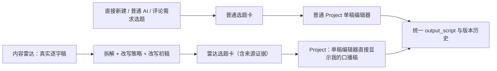

# T-642 内容雷达创作交接 BUILD Gate

日期：2026-08-02  
当前结论：核心数据与界面链路已实现，并已按 DEC-AI-025 改为分段结果优先、按
DEC-RADAR-028 将雷达改写稿直接填入现有项目编辑器，并按 DEC-RADAR-030
取消 Project 对标原稿双栏、统一口播稿读协议；任务保持进行中，
未构建安装包。

> 注意：仓库内原有 `GATE-T642-BUILD.md` 属于 2026-07-31 已完成的 Copilot 项目引用任务，不能覆盖。本任务沿用看板当前的 T-642 编号属于历史编号冲突，故本 Gate 使用 `-RADAR-` 后缀保留两份证据。该编号债务应在任务收口前登记并修正，不伪造或覆盖旧证据。

## 用户确认的产品分流

- 只有候选卡同时存在真实 `sourceReferences`、`sourceDecomposition`、`adaptationStrategy` 和 `adaptedDraft` 时，立项才写入 `briefDetail.contentRadarEvidence`。
- 普通选题与普通 Project 不生成伪来源、不注入雷达初稿，继续沿用原有单稿编辑器与普通写稿链。
- 内容雷达 Project 没有正式稿件版本时，以 `adaptedDraftSeed` 初始化现有编辑器；第一次保存仍由既有编辑器创建唯一的 `output_script`，之后正式 artifact 是唯一正文真相。
- 项目口播稿与来源逐字稿读取解耦：来源原稿只留后台证据，不进入 Project UI；已确认改写稿直接进入现有编辑器，项目不得退化为空白。
- 制作视频提词稿、项目审核和 Copilot 正文读取采用同一优先级：正式 `output_script` 优先，尚无正式版本时读取 `adaptedDraftSeed`。
- 普通 Project 未来显式增加对标时，不得覆盖已经存在的 `output_script`。

## 已实现

- 内容雷达 transform 仍由用户一次触发，但模型调用拆成“来源拆解→选题与策略→纯文本改写稿”
  三段；每段通过 backend service 写检查点，后段失败不清空前段。
- 全局 `runStructuredNode` 默认从最多隐式 6 次模型请求收敛为 1 次结构化尝试 + 1 次文本协议
  降级；只有显式 completion policy/调用参数才增加修复次数。
- confirm 将上述数据连同逐字稿 hash 与策略 hash 写入 Candidate，普通候选公开编辑接口不能伪造或覆盖这些来源证据。
- Candidate→Project 将完整雷达创作包投影到 Project Brief；普通候选不产生 `contentRadarEvidence`。
- `projects.intelligence.list` 可按 Project 读取已绑定来源、原链接和完整逐字稿。
- 内容雷达与选题中心保留来源证据；Project 稿面只显示改写后的口播稿，不再渲染对标原稿。
- 常规 `script.draft` 的 CreativeContext 已加入 `projectIntelligenceBrief`，雷达来源缺失时明确阻断，普通 Project 仍按旧上下文生成。

## 当前验证

| 检查 | 结果 | 证据 |
| --- | --- | --- |
| Contract | PASS | 27 files / 147 tests |
| Backend 聚焦 | PASS | 6 files / 101 tests（transform、confirm、promote、reference、CreativeContext、script runner） |
| AI Worker 聚焦 | PASS | 2 files / 25 tests |
| Frontend 聚焦 | PASS | 原 5 files / 71 tests；新增普通/雷达 Project 分流回归后，稿面 2 files / 12 tests |
| TypeScript | PASS | contract/backend/ai-worker/frontend typecheck 均通过 |
| 物理边界 | PASS | `boundary-scan` 无新增违规，剩余 5 条等于既有基线 |
| 孤儿扫描 | PASS | 0 errors；100 条既有/BUILD 期 warning |
| 格式 | PASS | `git diff --check` |
| 流程总账 | BLOCKED | `reconcile` 检出 T-642 SPEC hash 已变化，原评审回执过期；同时 T-635/T-645/T-653/T-656 存在既有回执问题。本轮不得冒充全绿或完成任务。 |

### DEC-AI-025 增量验证

- AI worker 三个聚焦文件：27 tests PASS，覆盖默认最多两次底层请求、分段 schema 与模板注册。
- `topic-preview-runner.test.ts -t T-646`：阶段 B 失败后，阶段 A 检查点保留、整链 finish 不执行、
  失败阶段被标记。
- `intelligence-workbench.test.tsx -t T-646`：改写失败后拆解/选题仍可见，采纳按钮因缺稿保持关闭。
- backend / ai-worker / frontend typecheck PASS（本机 Node 22 低于仓库声明 Node 25/24，只有 engine warning）。

### DEC-RADAR-028 增量验证

- `draft-workbench-page.bug8.test.tsx -t T-642`：覆盖普通项目不注入、雷达项目保持单稿且不渲染对标原稿、seed 直填、正式稿优先不被 seed 覆盖。
- `project-script-truth.test.ts`：4 tests PASS，覆盖 seed 解析、首次保存前回退、正式稿优先与正式空稿不回灌。
- `cross-account-gate.test.tsx`：新增制作视频在无正式版本时读取雷达口播稿；本轮前端聚焦 3 files / 23 tests PASS。
- `script-review-runner.bug9.test.ts`：4 tests PASS，审核 runner 可对 artifactVersion=0 的雷达首存前口播稿生成报告。
- `candidate.service.test.ts -t T-642`：1 test PASS，确认选题核心字段、来源拆解、四段策略和改写稿同次投影到 Project Brief。
- frontend typecheck PASS；三份本次前端文件 ESLint 0 error、1 条该数据装配文件既有 canonical client import warning。
- 上述命令均显式使用 `/opt/homebrew/opt/node@25/bin`，实际 Node `v25.9.0`，没有再误用 Node 22。

### 2026-08-02 旧项目“项目页仍为空”线上复核

- 对用户截图对应的本机项目做只读数据库审计：`projects.brief_detail.contentRadarEvidence`
  与 `project_intelligence_references` 均已完整保存，来源逐字稿、拆解策略和改写初稿没有丢失。
- 真正断点是 `projects.transport.ts` 的 row→DTO mapper 仍只手工复制旧版 7 个 Brief
  字段，`orientation` 与 `contentRadarEvidence` 在 `projects.get` 返回前被静默截断。
- mapper 已改为复用契约 `briefDetail` schema；旧项目无需重跑雷达或重建立项，升级后刷新即可
  进入既有单稿编辑器并显示改写稿。
- 新增契约回归：`projects.get` 必须逐字保留来源引用、拆解、四段策略与改写稿；聚焦 backend
  2 files / 14 tests PASS；原双栏结论已被 DEC-RADAR-030 取代，Project 只保留单稿。
- Node `v25.9.0` 下 backend/frontend/ai-worker typecheck PASS；boundary 无新增违规，
  orphan-scan 0 error（100 条既有/BUILD 期 warning）。

## 尚未完成，禁止把本 Gate 写成全量 PASS

1. Candidate promotion 后的 Project/reference 目前仍是顺序写入；需要失败注入证明不会留下“Project 已创建但 reference 缺失”的半成功结果。
2. 既有专用候选链有连续复用和语义相似检查；常规 `script.draft` 尚未完全收敛到同一可解释相似性采纳门。
3. Project 内调整 `keep/replace/add/avoid` 的交互尚未补齐。
4. 尚未跑真实浏览器的“雷达作品 → 确认选题 → 立项 → 首存稿件 → 刷新读回”双视口旅程。
5. Apple 安装包构建明确延后到所有问题统一完成后，本任务没有重复构建。

## Review 说明

- Round 1 的 `REV-001` 已通过事实、专有名词和清晰标注短引用的例外规则销账。
- Round 3 的 `REV-002` 针对“promotion 同时创建正式 output_script”会扩大跨模块原子边界。用户确认后已收敛为：promotion 只携带 `adaptedDraftSeed`，首次用户保存才沿用现有编辑器创建正式 artifact，因此该具体风险不再存在；这不是接受风险，也不伪造第 4 轮 PASS。
- 原始 Project/reference 原子性仍作为本任务未完成项保留。
- DEC-RADAR-030 改变了 Project UI 与读稿协议，导致 Round 1..3 的 T-642 SPEC hash 回执失效；
  当前实现回归已通过，但必须在后续任务收口前重新获得独立评审回执，现阶段保持 `CONCERNS`。
