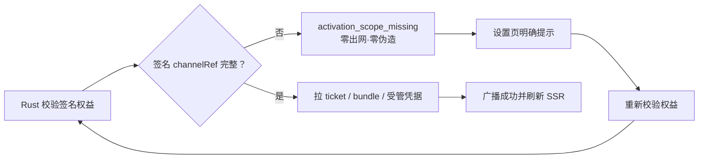

# T-701 BUILD 证据：缺渠道身份的失败关闭与恢复

日期：2026-08-05（America/Los_Angeles）

## 结论

- Activity 已签名放行但缺 `channelRef` 时，产品授权继续有效；CreatorOS 清掉旧渠道投影并稳定返回
  `activation_scope_missing`，不会猜测或继承一个无法由本次签名证明的渠道。
- sidecar 在创建缓存和任何 Activity/Growth 请求前失败关闭，因此 ticket、bundle、credential
  出网均为 0，已有缓存与凭据不改写。
- Rust、sidecar route 仅记录有限枚举的 `phase/reason/trigger/status`；任意响应文本先映射白名单，
  不记录授权码、机器标识、渠道身份、ticket、签名、bundle 或子 Key。
- Bootstrap 不再吞掉不可重试错误；设置页显示“授权缺少渠道信息，无法同步受管模型”，真实按钮
  依次执行 Rust `license_check`、本地可信 route 空 POST、成功广播与 `router.refresh()`。

## TDD 与自动验证

- RED：实现前新增 6 个失败点，分别证明通用授权错误、route 503、Bootstrap 静默、设置页误导文案、
  authority 错投影和成功后未刷新。
- 前端聚焦回归：6 个测试文件，82/82 通过；覆盖缺 ref 零出网/零缓存改写、route 409 脱敏映射、
  无 session、无 account、Bootstrap 可见错误、真实复校调用、成功广播/刷新，以及构建环境依赖文件。
- Rust：`license::tests` 71/71 通过；覆盖签名 status 缺 ref 清旧 scope 但不撤销授权、补 ref 后写入
  快照、触发源与日志原因白名单。
- `pnpm --dir frontend typecheck`、目标 ESLint、`cargo fmt --check`、boundary scan 与双向 orphan scan
  均通过。
- `pmem sync` 通过。全局 `reconcile` 的 LED-008、boundary、orphan 均通过；整体仍有 11 项既有
  review/frontend receipt 漂移，来自 T-675/T-691/T-656/T-653/T-645/T-642/T-635 及当前共享脏树
  中 T-668/T-664/T-663/T-657 的证据绑定，不把它们伪报为全绿。

## 诚实边界

- 用户明确要求本轮不打包、不发布，因此未生成安装包，也未把本地组件/跨层回归冒充真实安装版
  Activity → Growth → OmniHi live HTTPS 验收。
- 真签名补齐 `channelRef` 后的 Rust 快照写入，以及 sidecar 拉 bundle/受管凭据分别由跨层测试覆盖；
  真实生产网络与安装版回执继续留在 T-679 Program Gate。
