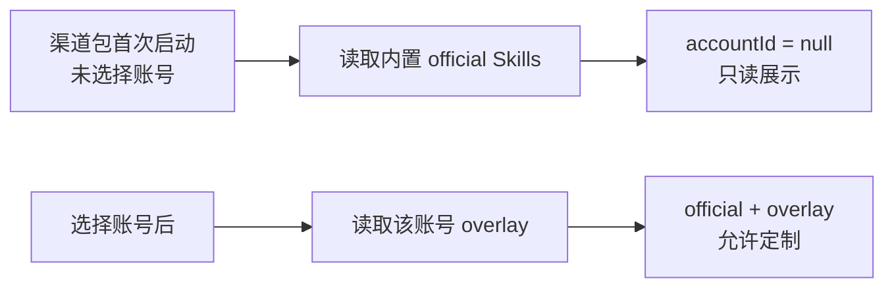

# T-722 BUILD Gate：渠道包 Skill 清单未选号可读

日期：2026-08-08
状态：实现、渠道包真机验证与用户验收通过。

```frontend-validation
{
  "schema": "frontend-validation/v1",
  "task_id": "T-722",
  "contract_path": "orchestrator/T722-FRONTEND-JOURNEY.md",
  "contract_sha": "6812aba0c8cd",
  "commit_sha": "b0851f4aa5d33235fd8c3f148b79ef80193e7503",
  "observed_at": "2026-08-09T01:08:00.000Z",
  "run": {
    "verify_key": "channel-skill-no-account:test",
    "command": "pnpm --dir frontend exec vitest run src/features/settings/skills-section.test.tsx -t \"未选择账号时\"",
    "exit_code": 0,
    "output_ref": "Vitest：未选择账号时可查看 official Skill、定制控件只读，1 passed"
  },
  "environment": {
    "surface": "desktop-app",
    "runtime": "智溯AI 0.3.0 macOS arm64 安装版 / Tauri WebView / production sidecar",
    "viewports": [
      { "width": 1440, "height": 900, "result": "pass" },
      { "width": 1024, "height": 720, "result": "pass" }
    ]
  },
  "data": {
    "mode": "non-fixture",
    "witnesses": [
      { "id": "zhisu-ai-local-install", "role": "fresh-channel-runtime-without-selected-account" }
    ]
  },
  "levels": {
    "logic": { "status": "pass", "evidence_ref": "Backend settings 32/32；Frontend settings 55/55" },
    "surface": { "status": "pass", "evidence_ref": "安装版设置页显示内置技能与未选号只读提示，不再显示技能清单不可用" },
    "journey": { "status": "pass", "evidence_ref": "独立渠道数据目录 → production sidecar /settings 200 → 用户打开设置技能页复核" },
    "experience": { "status": "pass", "evidence_ref": "用户真机确认：我检查了，已经没问题了。" }
  },
  "checks": [
    { "id": "AC-SKILLS-LIST", "test_id": "E2E-CHANNEL-SKILLS-01", "result": "pass", "evidence_ref": "安装 sidecar /settings 包含 script.draft 等内置技能" },
    { "id": "AC-SKILLS-NO-ACCOUNT", "test_id": "E2E-CHANNEL-SKILLS-02", "result": "pass", "evidence_ref": "未选号条目 accountId=null，页面提示选择账号后可定制" },
    { "id": "AC-SKILLS-NO-ERROR", "test_id": "E2E-CHANNEL-SKILLS-03", "result": "pass", "evidence_ref": "skills=$undefined 与技能清单不可用均未出现" }
  ],
  "coverage": [
    { "condition": "fresh-channel-install", "result": "pass", "evidence_ref": "/Applications/智溯AI.app 本地替换安装并启动", "reason": "" },
    { "condition": "no-selected-account", "result": "pass", "evidence_ref": "首页显示未绑定账号；Skill DTO 使用 accountId=null", "reason": "" },
    { "condition": "channel-data-isolation", "result": "pass", "evidence_ref": "bundle id 与 appDataDir 均为 com.zhisunet.zhisuai", "reason": "" },
    { "condition": "business-domain-independent", "result": "pass", "evidence_ref": "Skill 清单只读 runtime official registry；Growth 配置同步后仍可读", "reason": "" },
    { "condition": "installed-desktop-runtime", "result": "pass", "evidence_ref": "production sidecar /settings 返回 HTTP 200", "reason": "" }
  ],
  "visible_copy": {
    "artifact_path": "orchestrator/evidence/T-722-visible-copy.json",
    "artifact_sha256": "b83220bcd1677926081f9cbb8c765f2117204dd958be13a0c11d34cc790da5b1"
  },
  "tdd_red_ref": "修复前未选号用例抛出‘未选号不应读取账号覆盖库’，契约随后还能捕获 accountId=undefined",
  "open_defects": [],
  "status": "pass"
}
```

## 根因裁决

- 不是 Growth 五个业务域名改变了本地存储路径，也不是 Skill 被写到了 CreatorOS 共用目录。
- `智溯AI` 的 `appIdentifier=com.zhisunet.zhisuai`、应用数据、数据库、密钥、runtime 与 sidecar 均保持渠道独立。
- 真正根因是 `settings.prompts.list` 在首次启动尚未选择账号时，仍读取账号级 Skill overlay；随后联合目录 DTO 又把必填 `accountId` 产成 `undefined`。设置页捕获异常后只显示“技能清单不可用”，正常包因已有已选账号而未暴露。



## 红→绿证据

- RED：新增“未选择账号时不读取账号覆盖库”用例，修复前抛出 `未选号不应读取账号覆盖库`。
- GREEN：未选号时直接返回随 runtime 发布的 official catalog；只有存在 `ctx.accountId` 时才读取账号 overlay。
- Contract：`accountId: null` 明确表示当前没有账号覆盖；`get/put/history/rollback` 等账号写路径继续严格要求账号。
- 前端：未选号仍能查看 Skill，定制输入、保存、恢复与版本历史保持只读；真正读取失败时仅记录脱敏的错误名、错误码、requestId 与是否选号。

## 自动验证

- Backend settings：3 个测试文件，32/32 通过。
- Frontend settings：3 个测试文件，55/55 通过。
- Contract typecheck：通过。
- Frontend typecheck：通过。
- `boundary-scan`：无新增违规，剩余 5 条均为既有基线。
- Backend 全量 typecheck 被并行任务的 `artifacts.service.test.ts:156-157` 两处既有错误阻断；本任务 settings 测试已编译并通过，不冒充全绿。

## 渠道包真机验证

- 预检：`zhisu-ai/macos-aarch64` 通过。
- 本地构建：`pnpm -C frontend desktop:package-channel -- --manifest branding/packages/zhisu-ai/package.json --target macos-aarch64 --mode local-test` 成功。
- 产物：`/Users/zyongzhu/Downloads/智溯AI-0.3.0.dmg`；安装并启动 `/Applications/智溯AI.app`。
- bundle identifier：`com.zhisunet.zhisuai`。
- 独立数据目录：`~/Library/Application Support/com.zhisunet.zhisuai`；未退回 `cloud.aitongban.creatoros`。
- 安装后 sidecar `/settings` 返回 200，响应包含 `script.draft` 等内置 Skill，未选号条目为 `accountId:null`；旧 `skills=$undefined` 与“技能清单不可用”均未出现。
- Growth 配置启动同步成功；修复链不读取五个业务域名，因此业务域名变化不会改变 Skill 目录来源。
- 用户于 2026-08-08 真机复核：“我检查了，已经没问题了。”

## 发布边界

本次只生成本地测试包；未上传、未发布、未修改线上 Growth。不同渠道包的用户数据、密钥与配置继续物理隔离。
