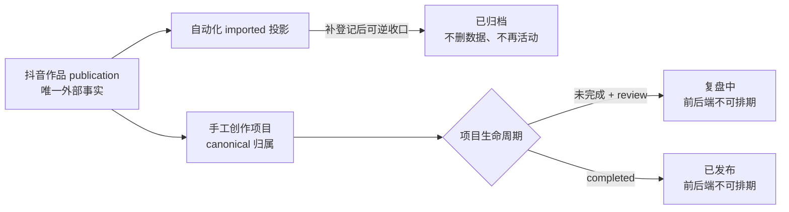

# T-724 BUILD Gate：作品归属收敛与复盘排期闭锁

日期：2026-08-08
状态：实现、独立规格复审、聚焦回归与本机真实数据界面旅程通过。

```frontend-validation
{
  "schema": "frontend-validation/v1",
  "task_id": "T-724",
  "contract_path": "orchestrator/T724-FRONTEND-JOURNEY.md",
  "contract_sha": "dbb597deb82c",
  "commit_sha": "489b256ee5b2324112a7cf3266cd411dd547a983",
  "observed_at": "2026-08-09T02:49:41.000Z",
  "run": {
    "verify_key": "project-publication-convergence:test",
    "command": "pnpm --dir frontend exec vitest run src/features/projects/projects-page.test.tsx src/features/draft-workbench/register-published-form.test.tsx src/app/api/v1/dispatch/route.test.ts",
    "exit_code": 0,
    "output_ref": "Vitest：项目生命周期、登记冲突与 dispatch 错误投影共 42/42 通过"
  },
  "environment": {
    "surface": "desktop-web",
    "runtime": "CreatorOS 本机 Next.js 运行态 / PGlite 真实账户数据库隔离副本 / Codex 内置浏览器",
    "viewports": [
      { "width": 1440, "height": 900, "result": "pass" },
      { "width": 1024, "height": 720, "result": "pass" }
    ]
  },
  "data": {
    "mode": "non-fixture",
    "witnesses": [
      { "id": "manual-review-project", "role": "同一外部作品的手工 canonical 项目，active + review + drafting output" },
      { "id": "archived-imported-projection", "role": "自动化先导入、补登记后被替代且可逆归档的 imported 项目" }
    ]
  },
  "levels": {
    "logic": { "status": "pass", "evidence_ref": "Backend ingestion/publishing/projects/content-calendar 122/122；Frontend/API 42/42" },
    "surface": { "status": "pass", "evidence_ref": "复盘项目显示‘复盘中 / 数据复盘’，归档投影显示‘已归档 / 项目已归档’，两者排期按钮均为 0" },
    "journey": { "status": "pass", "evidence_ref": "全部项目 → 复盘中 → 已归档双视口可见旅程；真实账户隔离副本、原数据库零写入" },
    "experience": { "status": "pass", "evidence_ref": "活动列表不再出现自动化僵尸投影；复盘项目不再展示误导性的排期操作；控制台 0 error" }
  },
  "checks": [
    { "id": "AC-PROJECT-CANONICAL-OWNER", "test_id": "E2E-T724-01", "result": "pass", "evidence_ref": "真实数据中手工项目保留创作内容并成为唯一可操作归属；publishing/ingestion 并发与幂等测试通过" },
    { "id": "AC-PROJECT-ARCHIVED-HIDDEN", "test_id": "E2E-T724-02", "result": "pass", "evidence_ref": "被替代 imported 投影从全部/已发布剔除，只在‘已归档 1’中显示，数据未删除" },
    { "id": "AC-PROJECT-REVIEW-TAB", "test_id": "E2E-T724-03", "result": "pass", "evidence_ref": "本机真实 active + review + drafting output 项目归入‘复盘中 1’，显示‘数据复盘’" },
    { "id": "AC-PROJECT-REVIEW-NO-SCHEDULE", "test_id": "E2E-T724-04", "result": "pass", "evidence_ref": "1440×900 与 1024×720 下排期按钮均为 0；ContentCalendar 新建、改期、取消全部 fail closed 且保留旧行" }
  ],
  "coverage": [
    { "condition": "real-account-data", "result": "pass", "evidence_ref": "读取本机真实账户数据库隔离副本；页面显示 52 个非归档项目、1 个复盘项目、1 个归档项目", "reason": "" },
    { "condition": "manual-project-and-imported-projection-for-same-publication", "result": "pass", "evidence_ref": "手工创作项目与自动化 imported 投影的补登记冲突组合已在真实数据和 service 回归中覆盖", "reason": "" },
    { "condition": "archived-imported-projection", "result": "pass", "evidence_ref": "替代投影仅在已归档 Tab 可见，阶段与排期静态文案均为‘已归档’", "reason": "" },
    { "condition": "active-review-drafting-output", "result": "pass", "evidence_ref": "真实项目在 output 仍为 drafting 时由 currentStage=review 正确归入复盘中", "reason": "" },
    { "condition": "backend-schedule-fail-closed", "result": "pass", "evidence_ref": "ContentCalendar 21/21：review/archived/completed 项目无法新建、修改或取消排期，历史行保留", "reason": "" },
    { "condition": "normal-and-minimum-viewports", "result": "pass", "evidence_ref": "1440×900 与 1024×720 真实浏览器旅程均通过", "reason": "" }
  ],
  "visible_copy": {
    "artifact_path": "orchestrator/evidence/T-724-visible-copy.json",
    "artifact_sha256": "3884349e2ab3da203a4a2d331f8c3f46562d7e7ef104f716f92042cae63aac5c"
  },
  "tdd_red_ref": "修复前新增前端用例把 active+review+drafting 项目错误留在进行中并渲染排期；新增后端用例允许 review 项目改期。实现生命周期解释器与后端写门后转绿。",
  "open_defects": [],
  "status": "pass"
}
```

## 根因与收敛规则

- 外部作品只有一条 `publication` 事实；自动化 imported 项目只是可重建投影，手工创作项目可以接管归属。
- 接管成功后，所有同作品 imported 投影由 Projects 在事务内幂等归档并写活动；不删除项目、封面、媒体、指标、版本或历史排期。
- 首次创建、同 output 重复登记、孤儿修复、imported→manual 换锚和后续自动化都调用同一收口函数；补偿失败可重试。
- 项目列表由单一生命周期解释器决定 Tab、阶段、颜色和排期：archived 优先；completed 为已发布；未完成 review 为复盘中；来源不再覆盖生命周期。
- ContentCalendar 后端对 archived、completed、review 项目的新建、改期、取消统一拒绝，旧页面和直接请求无法绕过。



## 自动验证

- Backend：ingestion、publishing、projects、content-calendar 共 122/122 通过。
- Frontend：项目页与登记发布组件 27/27；dispatch 15/15；前端 typecheck 通过。
- `boundary-scan`：无新增违规，剩余 5 条均为既有基线。
- `semantic-boundary-scan`：通过。
- `orphan-scan`：0 error；仅保留项目既有 PLANNED/未追踪警告。
- Backend 全量 typecheck 仍被并行任务的 `artifacts.service.test.ts:156-157` 两处既有错误阻断；T-724 聚焦测试已编译并通过，不冒充全绿。

## 数据安全与发布边界

- 真机验收只使用本机数据库隔离副本；原数据库未写入、未删除。
- 验收副本已移到废纸篓，可恢复；没有删除任何用户项目或素材。
- 本次未打包、未发布、未上传。
