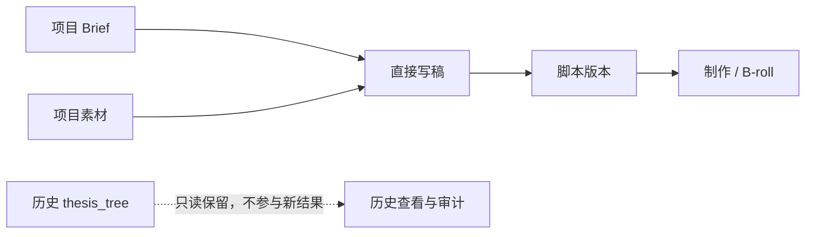

# T-726 BUILD Gate：退役“论点骨架”

日期：2026-08-08  
状态：实现、独立规格复审、聚焦回归与本机真实浏览器验收通过；正式 strict receipt 尚未绑定提交。

## 交付结论

- 稿面删除“论点骨架”面板、“立论点”入口和 Copilot 论点卡；设置页不再登记该 Skill。
- `planning.thesis` 新任务与历史任务确认在领域服务层统一拒绝，且拒绝发生在候选或 artifact 写入之前。
- 新写稿、策划、重建和 B-roll 只消费 Brief、脚本与项目素材，不再暗读或生成 `thesis_tree`。
- 历史 `thesis_tree` artifact/version 与旧脚本版本只读保留；没有迁移、覆盖或删除用户数据。

## 自动验证

- Backend：8 个聚焦测试文件，506/506 通过。
- Frontend：两轮聚焦回归分别 107/107、57/57 通过；Frontend typecheck 通过。
- AI Worker：2 个测试文件，30/30 通过；typecheck 通过。
- Contract typecheck 通过；`git diff --check` 通过。
- `boundary-scan`：无新增违规，5 条既有基线保留。
- `semantic-boundary-scan`：通过。
- Backend 全量 typecheck 仍被并行任务在 `artifacts.service.test.ts:156-157` 的两处既有类型错误阻断；本任务聚焦测试已编译通过，不冒充全绿。
- Contract registry 测试仍被并行任务新增但尚未登记的 `POST /artifacts/:artifactId/script-patches/apply` 阻断，与本任务删除 `planning.thesis` 无关。

## 真实页面验收

证据：`orchestrator/evidence/T-726-browser-observation.json`

- 1440×900：素材上传、联网找资料、创作素材和口播脚本可见；退役三处文案均不可见；无横向溢出。
- 1024×768：同样通过，刷新后结果不反弹；无横向溢出。
- 验收只使用隔离 PGlite；用户原数据库零写入。隔离库已移入废纸篓，可恢复。

## 流程诚实边界

当前主工作区同时存在多个任务的大量未提交改动，且部分 T-726 文件与其他任务共享。`receipt_policy=required` 要求 report 绑定当前 HEAD 且所有 watched paths 无任何 staged/unstaged 漂移；在不把用户或并行任务改动夹带进提交的前提下，无法诚实生成 strict receipt。因此本 Gate 记录真实运行证据，但不伪造 `PASS:<hash>`，T-726 暂不执行 `taskctl complete`。待共享工作区的相关改动形成清晰提交边界后，再绑定 receipt 并正式收口。

本次未打包、未发布、未上传。
