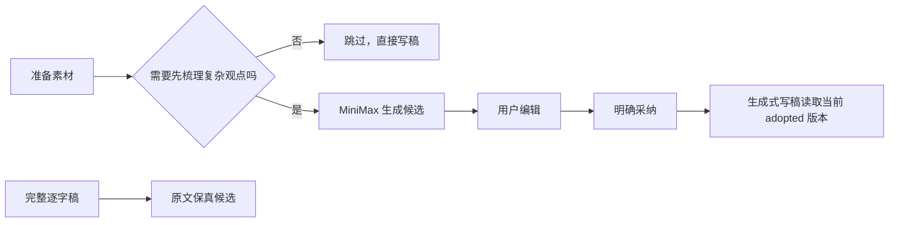

# T-730 BUILD Gate：可选论点骨架恢复

日期：2026-08-09  
状态：业务实现、独立规格复审、聚焦回归和隔离真实页面检查通过；共享脏工作区尚不满足 strict receipt 的提交绑定条件。

## 用户结果

- 稿面恢复固定四栏“论点骨架（可选）”，同时说明适用与可跳过场景。
- “先梳理观点”真实分派 `planning.thesis` 候选，继续复用受管文本模型；当前渠道为 MiniMax 时走 MiniMax，不新增单独设置或密钥。
- 未明确采用的历史论点、运行中候选和失败候选都不进入写稿；采用与停用都追加不可变版本。
- 完整逐字稿继续走 T-727 保真路径，不读论点、Brief 或定位。
- 保存、采用、停用都带当前版本并发门；旧页面不能覆盖后来保存的新版本。

## 自动验证

- Frontend：7 文件，121/121 通过；typecheck 通过。
- Backend：T-730 聚焦 6 文件，12/12 通过；MiniMax/渠道路由 24/24 通过；新增并发门先红后绿。
- AI worker：提示词与 grounding 30/30 通过；typecheck 通过。
- Contract：typecheck 通过。
- `boundary-scan`：无新增违规，5 条既有基线不变。
- `semantic-boundary-scan`：通过；未恢复 token、Dice、关键词或业务名素材匹配。
- `orphan-scan`：0 error，保留既有 PLANNED/未追踪 warning。
- Backend 全量 typecheck 仍被共享工作区的 `artifacts.service.test.ts:156-157` 两处既有类型错误阻断；T-730 新增服务测试和相关模块测试均已编译通过。

## 真实页面检查

- 隔离账号与项目下可见“论点骨架（可选）”、场景说明、“先梳理观点”和“跳过，直接写稿”。
- 点击跳过后焦点落到 `#script`。
- 停服后核对隔离库：当前项目的 `planning.thesis` task、`thesis_tree` artifact 和 version 均为 0。
- 证据：[T-730-browser-observation.json](evidence/T-730-browser-observation.json)。

## 数据与发布边界

- 未读取、写入或删除用户真实项目、稿件、素材和历史论点。
- 未删除历史 `thesis_tree`。
- 未打包、未发布。
- 当前共享工作区含大量并行任务修改，T-730 没有整文件回滚，也没有提交或覆盖无关改动；因此暂不伪造 strict frontend receipt。
