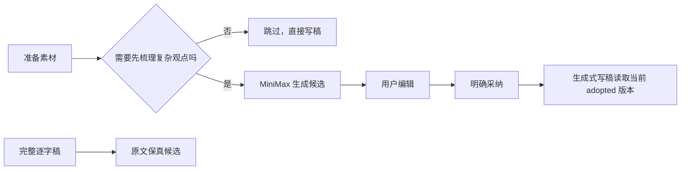

# T-733 BUILD Gate：可选论点骨架恢复

日期：2026-08-09
状态：业务实现、独立规格复审、聚焦回归、边界门与隔离真实页面来源证据通过；待提交后在确定 SHA 上换发 strict receipt。

## 用户结果

- 稿面恢复固定四栏“论点骨架（可选）”，同时说明适用与可跳过场景。
- “先梳理观点”真实分派 `planning.thesis` 候选，继续复用受管文本模型；当前渠道为 MiniMax 时走 MiniMax，不新增单独设置或密钥。
- 未明确采用的历史论点、运行中候选和失败候选都不进入写稿；采用与停用都追加不可变版本。
- 完整逐字稿继续走 T-727 保真路径，不读论点、Brief 或定位。
- 保存、采用、停用都带当前版本并发门；旧页面不能覆盖后来保存的新版本。

## 自动验证

- Frontend 聚焦：5 文件，38/38 通过；全仓 ESLint 0 error、164 条既有 warning。
- Backend 聚焦：7 文件，449/449 通过；其中被并发替换的两份回归已恢复为 84 与 12 个用例。
- AI worker 聚焦：1 文件，18/18 通过。
- 全工作区 typecheck：5/5 workspace 通过。
- `test-integrity`：0 error、1 条既有 coverage 配置 warning；用例/断言没有净下降。
- `boundary-scan`：无新增边界违规；`semantic-boundary-scan` 通过；`orphan-scan` 0 error。
- `reviewctl audit`：评审收据与 hash chain 通过。
- 按用户要求未运行视觉校验，也未修改视觉资产或快照。

## 真实页面检查

- 隔离账号与项目下可见“论点骨架（可选）”、场景说明、“先梳理观点”和“跳过，直接写稿”。
- 点击跳过后焦点落到 `#script`。
- 停服后核对隔离库：当前项目的 `planning.thesis` task、`thesis_tree` artifact 和 version 均为 0。
- 原始证据保留于 `orchestrator/evidence/T-730-browser-observation.json`；编号冲突收口后改记为 T-733 来源证据，不冒充本轮重新执行。

## 数据与发布边界

- 未读取、写入或删除用户真实项目、稿件、素材和历史论点。
- 未删除历史 `thesis_tree`。
- 本轮只合并代码并准备本地官方预览包，不创建 tag、GitHub Release 或生产放量。
