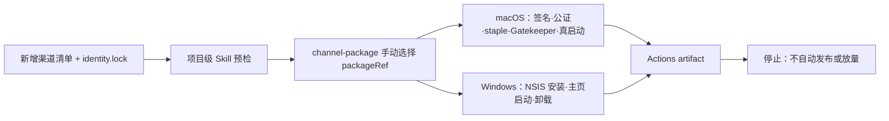

# T-753 BUILD 证据：可复用 N 渠道 GitHub 双平台正式构建

日期：2026-08-10（America/Los_Angeles）

## 结论

PASS。仓库新增独立的手动 `channel-package` workflow，并把本地预检、本地测试包、GitHub 正式包、
平台验收与发布停止点固化进项目级 `packaging-creatoros-channel` Skill。智溯AI `zhisu-ai` 已用同一
候选提交完成 macOS/Windows 正式渠道包实跑；只生成 GitHub Actions artifact，没有创建 tag、
GitHub Release、CDN 条目，也没有修改 Growth、Activity 或对用户放量。

## 可复用能力

- GitHub workflow：`.github/workflows/channel-package.yml`，与官方 `desktop-release.yml` 物理分离，
  仅允许 `workflow_dispatch` 输入 `package_ref` 与 `macos/windows/all`。
- 渠道输入只读取当前提交中 `frontend/branding/packages/<packageRef>/package.json`、
  `identity.lock.json` 与清单列出的图标；拒绝任意路径、脏输入和身份漂移。
- N 个渠道复用同一构建入口；新增渠道只需按既有渠道档案流程提交清单、身份锁和素材，禁止在打包时
  顺带修改产品功能、界面或视觉。
- 项目级 Skill：`.agents/skills/packaging-creatoros-channel/SKILL.md`；明确区分计划、本地测试包、
  GitHub 正式包与对外发布，并给出统一的 `gh workflow run channel-package.yml` 入口。
- 按用户要求，打包 Gate 不执行截图、像素或视觉回归；仍保留静态品牌消费、清单、身份锁和图标摘要
  校验。
- Windows 首次启动不再使用 45 秒硬门；等待真实 `MAIN_PAGE_LOAD_FINISHED`，异常挂死上限为 300 秒。

## GitHub 正式实跑

- 运行：[channel-package #31383743588](https://github.com/zzyong24/Thirdspace-creator/actions/runs/31383743588)
- 候选提交：`7263a81d6ea3b06cf942d3ba880e2662d0670ddf`
- 渠道：`zhisu-ai`（智溯AI，`partner-p501444c`）
- 版本：`1.0.0`
- plan job：PASS；当前提交清单、身份锁、图标与双平台 release plan-only 全部通过。
- macOS job：PASS（24m13s）。Developer ID 签名、公证、staple、DMG 与挂载后 app Gatekeeper、
  `com.zhisunet.zhisuai` 身份和真实进程启动全部通过。
- Windows job：PASS（25m13s）。NSIS 内含 sidecar、静默安装、`runtime-current.txt`、`ZhisuAI.exe`、
  本地主页面真实启动与静默卸载全部通过；验证步骤耗时约 85 秒，因此未受旧 45 秒门影响。
- Windows Authenticode：`unsigned-accepted-risk`。这是用户已接受的当前发布边界，不能宣称为已签名。

## Artifact 元数据

未下载 artifact；以下均直接读取 GitHub Actions 元数据与成功上传日志。

- [macOS artifact #9061786080](https://github.com/zzyong24/Thirdspace-creator/actions/runs/31383743588/artifacts/9061786080)
  - 名称：`zhisu-ai-macos-aarch64-1.0.0-7263a81d6ea3b06cf942d3ba880e2662d0670ddf`
  - 大小：468,080,672 bytes
  - Actions ZIP SHA-256：`2a822328e8006f7ad5554329e62f6377aca34ff5c86676ca01b8b5a6c5668927`
- [Windows artifact #9061812255](https://github.com/zzyong24/Thirdspace-creator/actions/runs/31383743588/artifacts/9061812255)
  - 名称：`zhisu-ai-windows-x86_64-1.0.0-7263a81d6ea3b06cf942d3ba880e2662d0670ddf`
  - 大小：476,042,477 bytes
  - Actions ZIP SHA-256：`b7cafb4c9a210a3b6991c95141b509610c973bfebc32e38e90ce8246c3e608bd`
- 两个 artifact 均包含平台安装包、渠道 attestation、release manifest/attestation 和
  `channel-package-evidence.json`；保留期至 2026-08-24。

## 自动验证

- 渠道打包聚焦测试：4 files / 21 tests PASS。
- frontend typecheck：PASS。
- `test-integrity`：0 errors；1 个既有 coverage config warning。
- 项目级 Skill `quick_validate.py`：PASS。
- `zhisu-ai` macOS/Windows `release --plan-only`：PASS。
- workflow YAML 解析与 `git diff --check`：PASS。
- 官方 `.github/workflows/desktop-release.yml` 未修改。
- workflow/渠道范围秘密模式扫描：未发现入库秘密；正式值只通过 GitHub Secrets/Variables 注入。

## 全局 reconcile 诚实结果

- `pmem sync`：PASS。
- boundary：无新增违规，仓库仍保留基线内 5 条；semantic boundary：PASS。
- orphan：0 errors / 100 个既有 warning，双向链路 clean。
- `reconcile`：3 errors / 9 warnings，未伪报全绿。3 个错误均是本任务范围外的既有回执漂移：
  T-746 review receipt，以及 T-727、T-722 frontend receipt；本任务未修改这些 watched paths，也未改写
  历史 receipt。T-753 的渠道打包聚焦 Gate 与 GitHub 双平台实跑均独立通过。

## 发布停止点

- 当前只完成安装包构建与 Actions artifact 上传。
- 未创建 `v1.0.0` tag、GitHub Release 或对外下载入口。
- 未修改生产 Activity `latestVersion/downloadUrl`、Growth 配置或任何渠道公告。
- artifact 是否转为正式下载/分发仍需用户在发布检查点再次明确确认。
