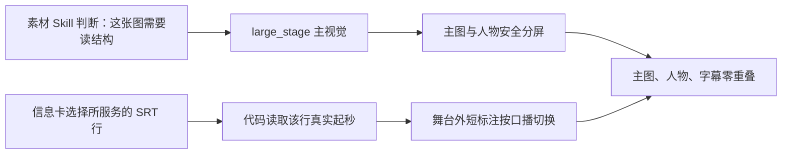

# T-823 构建验证：主视觉不再被大卡遮挡，卡片跟当前口播切换

## 用户能直接看到的变化

此前四层架构图虽然已经生成并进入成片，但被当成左上角辅助图；巨型黑卡覆盖主舞台，而且“模式层”
会延续到口播已经进入“可观测层”之后。现在的规则是：需要读结构的图承担主视觉，人物在右侧安全区；
信息卡只在主图上方做短标注，并以真实 SRT 行为切换时钟。

## 实现边界

- `material.match v9` 由 AI 判断素材是否需要阅读；架构图、流程图、数据表、界面/代码截图承担解释或证据时必须选 `large_stage`，代码没有增加文件名词表。
- `video.cards v5` 新增可选 `srtLineIndex`；新模型输出用真实 SRT 行起秒，旧候选仍兼容原 `at`。
- 渲染器在主图持续期间把卡片改为主图边界外的 58px 短标注；任意真实素材进场都会结束此前的大卡。
- 未修改正式数据库、用户素材或当前成片；预览只是本地 12 秒关键帧，不冒充正式导出。

## 证据

- AI 模板测试：13/13 PASS。
- 后端决策与渲染测试：140/140 PASS，含 SRT 行绑定、overlay 最坏情况、大图期间短标注和横竖快照。
- 真实素材 Chromium 预览：第 2 秒“模式层”、第 8 秒“可观测层”；两帧均为主图/人物/字幕零重叠，大卡数量 0。
- 预览命令：`node orchestrator/process/verify-t823-main-visual-preview.mjs <talking-head-video> <architecture-image>`。
- `pmem sync` PASS；`reconcile` 中 LED-025、语义边界、物理边界均 PASS。全局 reconcile 仍因既有
  BACKLOG 过长、T-770/T-765/T-746 旧审核回执过期及工作区其他任务未提交漂移共报 14 errors；
  这些不是本任务新失败，未冒充全局全绿。

## 尚未冒充完成的验收

用户尚未确认这版关键帧，因此没有重跑 2 分 11 秒正式成片。按视频预览门，需用户认可布局后才能把
同一规则用于正式导出；当前任务只能标记为“实现完成、待预览验收”。
