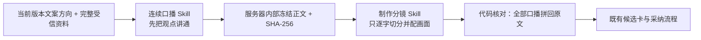

# T-824 构建验证：先写连续口播，再做逐字分镜

## 用户能直接看到的变化

点击一次“写稿”仍得到原来的可编辑分镜候选，但系统内部不再要求同一次模型调用同时完成观点、
口播、画面、字幕、时长和素材引用。第一步只负责把内容讲通，第二步只能切分已经冻结的正文并补
制作字段，因此旧结构方案不会再被机械照抄成成稿目录，分镜也不能偷偷改写口播。

## 实现边界

- 新增 `script.voiceover.compose v1` 与 `script.storyboard.segment v1` 两个可配置 Skill；新任务创建时
  与兼容用 `script.draft` 一起冻结版本。
- 当前明确方向和完整受信资料仍为最高优先；论点、合同、结构方案只约束必须覆盖的信息，不再强制
  成为口播目录。
- 连续口播成功后才写入 server-only 断点；公开任务对象、前端与步骤日志都不暴露正文。
- 分镜口播逐字符拼接不等于冻结正文时，只重做分镜一次；仍不一致则真实失败且不生成候选。
- 同任务恢复或显式重试会校验输入指纹、Skill 版本、正文长度和 hash，合法时复用连续口播，避免重复
  计费；残缺或被篡改的断点失败关闭。
- 已有账号 `script.draft` 覆盖和升级前只冻结旧 Skill 的排队任务继续走旧单阶段兼容链，不静默改变
  用户方法。
- 未做 T-820 的内容血缘重构，也未做 T-814 的跨页面统一会话。

## 自动化证据

- 两阶段 runner、旧链兼容、断点恢复、分镜逐字校验与二次失败：20/20 PASS。
- AI worker 模板与节点聚焦回归：18/18 PASS。
- 后端 Skill 快照、AI 服务、server-only 断点与设置合同：115/115 PASS。
- 前端 Skill 展示与写稿任务输入：29/29 PASS。
- `ai-worker`、`backend`、`frontend` TypeScript 类型检查全部通过。
- `pmem sync` PASS；语义边界与物理边界均无新增违规。全局 `reconcile` 仍有 14 项既有错误：
  BACKLOG 体积欠债、T-770/T-765/T-746 旧审核回执过期，以及多项历史 frontend receipt 被后续代码
  变化或本任务未提交状态判定失效；这些没有冒充全局全绿，也不属于本任务新增的运行失败。

## 尚未冒充完成的验收

自动化只能证明两阶段真实执行、断点不泄露、口播不被分镜改字，不能证明某篇内容一定更好。用户需
在 v1.1 本地包里用真实 DeepSeek Harness 主题和另一个不同关系的主题各生成一次，重点判断：核心
判断是否前置、前半段是否仍像资料目录、整篇是否能连续口播。用户确认前，T-824 保持“待验”。
