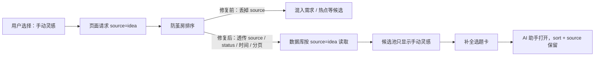

# T-827 构建验证：选题中心来源筛选与操作按钮

日期：2026-08-13（America/Los_Angeles）

## 用户能感知到的变化

- “防茧房推荐”不再绕过来源条件。选择“手动灵感”后，候选池只显示 `source=idea` 的候选。
- 当前筛选变成可直接点击的“清除”按钮，不必猜要去左栏再点一次。
- “补全选题卡”打开 AI 助手后会保留原来的排序和来源；关闭助手仍回到同一批候选。
- 左栏无法精确映射到候选来源的五项明确显示“仅统计”，并解释它们是上游信号或资料存量，不再伪装成失灵的筛选按钮。
- 能精确筛选的“行业热点 / 手动灵感”显示候选池真实数量，不拿上游统计数冒充筛选结果数。

## 问题与修复路径

## 自动化证据

- 后端：`topic-preference-flywheel.test.ts`，16/16 通过；新增“防茧房 + 来源过滤”回归用例。
- 前端：`topics-interactions.test.tsx`，25/25 通过；覆盖真实候选数、仅统计说明、清除筛选、补全深链保留状态。
- 后端 TypeScript：通过。
- 前端 TypeScript：通过。
- ESLint（本次两个前端文件）：0 error；测试文件保留 5 个既有未使用参数 warning。
- 物理边界、语义职责边界、双向孤儿链、测试防弱化门：全部通过，无新增违规。
- `reconcile`：仍报告仓库既有 14 项全局漂移（看板体积、旧任务 review/frontend receipt 失效）；本次相关 boundary / orphan / lesson guards 均通过，未把全局历史欠债伪报为全绿。

## 真实页面旅程

使用独立临时 PGlite 数据库和本地测试账号，创建：

- 2 条 `idea` 候选；
- 1 条 `trend` 候选。

验证结果：

1. 打开 `/topics?sort=guardrail&source=idea`，候选卡为 2 张，来源均为 `idea`。
2. 点击“补全选题卡”，AI 助手正常打开，选中候选正确，URL 仍保留 `sort=guardrail&source=idea`。
3. 关闭 AI 助手后点击“清除来源筛选”，URL 回到 `?sort=guardrail`，候选卡恢复为 3 张。
4. 在 1024×768 最小验收视口重复打开筛选页：2 张手动灵感卡、“清除来源筛选”、“补全选题卡”和“仅统计”说明均可访问。

## 范围边界

本次没有改候选语义判断或数据归属。评论问题、客户咨询、知识库资料、历史爆款、项目复盘目前没有能一对一落到 `candidates.source` 的来源标记，因此只做诚实说明；若要把这五项也升级成精确筛选，需要另行设计候选来源溯源字段与存量迁移，不能用“评论和咨询都映射为需求”这种混筛假装完成。
