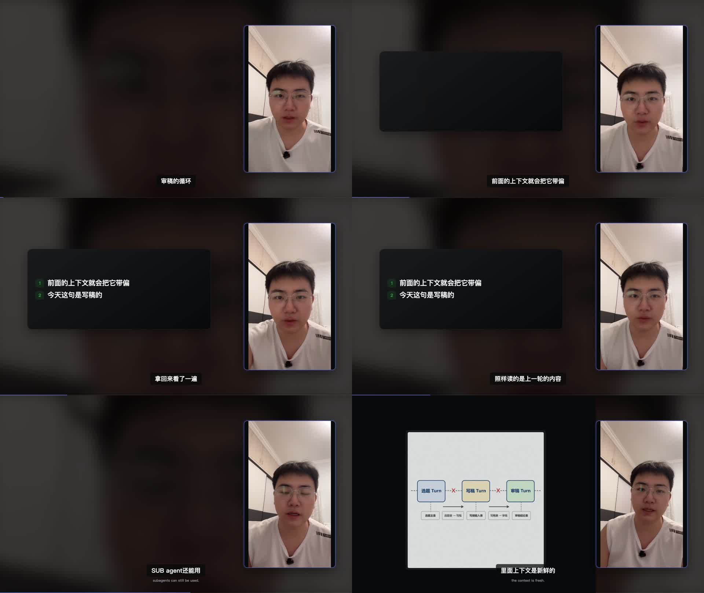

# T-839 内容动效与横屏黑舞台修复验收

> 日期：2026-08-14
>
> 阶段：4-build；本地安装包结果在代码冻结构建后回填。
>
> 真实回归来源：T-838 的 157.27 秒渲染任务时间线、原口播和 8 个真实素材。

## 大白话结论

这次不是把背景“稍微调亮”，而是把三条断掉的链路一起接回：模型按真实口播生成的合法动画不再被误删；
大图结束后，刚才被压成标注的信息卡会重新回来；确实没有卡片或素材的短空窗，用同一段人物视频做低亮度
模糊背景承接。若模型最后只留下系统基础卡，界面会明确说“未生成 Scene Graph 内容动效”，不再把降级冒充
成优化成功。

## 修复与证据

| 故障 | 修复 | 验收证据 |
| --- | --- | --- |
| 冻结稿与真实口播措辞不同，合法 `visualPlan` 被整张剔除 | 可溯语料改为“冻结稿 + 权威 SRT”，仍坚持逐字可溯，不做同义猜测 | 新红测修复前 `cards=0`，修复后保留 1 张完整 Scene Graph |
| 14 张基础 `list + reveal` 被写成总导演优化成功 | 导演结果统计“内容动效 / 基础补位”；纯补位使用 `deterministic_fallback` 并明确未生成内容动效 | `closeDirectorReview` 回归断言 summary 与 source |
| 25.40–35.53 秒：卡片在大图窗内被 `continue` 永久丢掉 | 若没有更新视觉节拍，卡片在 `large_stage` 结束后恢复至本场结束 | 25.6s、30s、35s 均检测到 1 张活动信息卡 |
| 0–3.37 秒、84.48–86.33 秒：横屏左舞台无当前视觉 | 横屏全程预铺同源、静音、低亮度模糊人像底层；主素材和卡片仍在更高层 | 1.5s 与 85s 均检测到活动氛围层；86.5s 检测到真实主素材 |

## 自动检查

- TDD 红测：实现前 3 项失败（SRT 合法动效被清空、横屏短空窗无氛围层、主图结束后卡片不恢复）。
- 定向回归：143 项通过。
- 后端全量：224 个测试文件通过、2 个跳过；2880 项通过、4 项跳过。
- 后端类型检查：通过。
- 语义边界：通过；新增确定性代码只守逐字来源与时间窗，不替模型做创作选择。
- 物理边界：无新增违规，存量 5 条仍在既有基线内。
- 真实时间线：六个关键帧全部通过，预览页面无运行错误。

## 本地包

待代码提交并冻结后，按官方 `desktop:package-local` 流程构建；随后回填文件、SHA-256、DMG 校验、真安装与真实启动结果。
