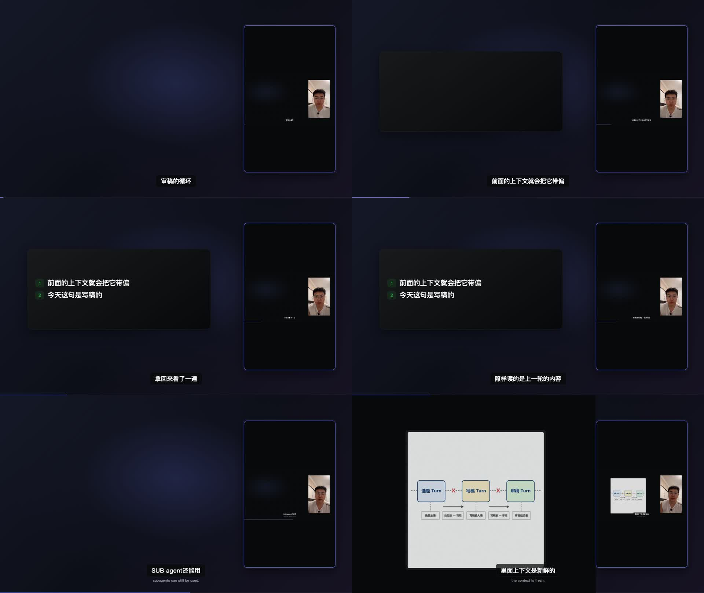

# T-841 视频渲染总时限与横屏氛围层修复验收

> 日期：2026-08-14  
> 候选提交：`988c64707470689517fb736a8308080b183d6531`  
> 阶段：4-build + 本地官方包验收完成。

## 大白话结论

视频渲染不再因为“总共跑了 30 分钟”被一刀切中止。这个例外只给 `video.render`；普通执行任务的
安全超时没有放开。用户点击丢弃仍会立刻中止渲染和子进程。

横屏也不再复制一条全长人物视频做 42px 动态模糊。现在空窗使用没有媒体解码、没有逐帧滤镜的
静态渐变氛围底，真实人物、素材、信息卡与字幕层级不变。

## 红绿证据

- RED：契约拒绝 `timeoutSec: null`；两个真实创建入口仍发送 `1800`；模板仍生成第二个全片
  `<video id="thAmbient">`。红测分别按预期失败。
- GREEN：contract 9/9；后端执行与模板 74/74；前端两个真实入口 33/33。
- 三端类型检查通过；语义边界通过；物理边界无新增违规，存量仍为基线内 5 条。
- 只有 `video.render` 可声明 `timeoutSec: null`；`echo.manifest` 等其他执行类型传 null 会被契约拒绝。
- 无固定总时限路径的延迟完成与用户丢弃均有后端测试；步骤流明确显示“无固定总超时，可由用户取消”。

## 157 秒真实时间线

复用 T-840/T-838 的 157.25 秒、4718 帧、7 场景、8 B-roll 真实规模和用户原视频，按当前模板重建
并用 Chromium 逐点检查：

| 时间 | 预期 | 结果 |
| ---: | --- | --- |
| 1.5s | 空窗有静态氛围底 | 通过 |
| 25.6s | 信息卡恢复 | 通过 |
| 30.0s | 信息卡持续 | 通过 |
| 35.0s | 信息卡持续 | 通过 |
| 85.0s | 短空窗有静态氛围底 | 通过 |
| 86.5s | 真实主素材进入 | 通过 |

页面无运行错误；当前 HTML 只有一条全片人物 `<video>`，不存在第二条 `thAmbient` 视频，也不存在
`filter:blur(42px)`。没有自动重试用户失败任务，也没有修改用户素材。

## 本地包

冻结前工作树干净；四处版本均为 1.1.0；候选差异未发现密钥模式；官方打包四项预检 42/42 通过。
构建期间没有修改产品代码、测试或文档。

| 项目 | 结果 |
| --- | --- |
| 文件 | `/Users/zyongzhu/Downloads/CreatorOS-1.1.0.dmg` |
| 大小 | 430,060,982 bytes |
| SHA-256 | `d27d0cdac59834a9a5b85901a2dc633fe2b33110536f08d29e1879cc93c9e178` |
| DMG 完整性 | `hdiutil verify`：VALID |
| 安装 | 已替换为唯一 `/Applications/CreatorOS.app` 并启动，GUI PID 33572 |
| 应用结构签名 | `codesign --verify --deep --strict`：valid on disk，满足 Designated Requirement |
| 内嵌服务 | 动态端口 57341；安全日志 `SIDECAR_STARTUP_VERIFIED`；主页面 HTTP 200 |
| 正式签名 / 公证 | 未配置 Developer ID 与公证凭据；`signed:false`、`notarized:false`，仅为本地验收包 |

## 未执行

未推送、未创建 tag/GitHub Release、未修改 Activity/Growth 下载地址、未公开分发，也未自动发起新的
157 秒正式渲染任务。真实全片渲染由用户在新安装包里按正常制作流程触发；本次不替用户新增候选或消耗时间。
