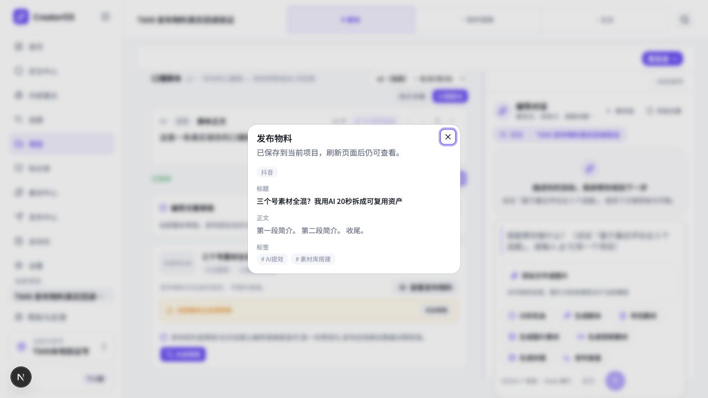

# T-849 构建验证：发布物料简介与标签回读

## 结论

用户截图中的数据没有丢失。根因是同一个作品下同时存在两条发布记录：一条是只有标题的“已发布事实”，另一条才是 AI 生成的完整发布物料。旧页面固定读取列表第一条，因此把真实存在的简介和标签显示成“暂无正文 / 暂无标签”。

本次修复后：

- 新生成的简介会把换行、空行、制表符和连续空白折叠成一个普通空格，文字与标点不改写。
- 查看弹窗会遍历当前作品下各条发布记录，优先展示含真实简介或标签的当前版本。
- “是否已发布”与“当前展示哪条物料”分开判断；查看完整生成物料时仍保留已发布状态，也不会再次出现“登记已发布”。
- 已保存的多行简介在读取展示时也会收成一行，不迁移、不覆盖用户数据库。



## 根因证据

通过 CreatorOS 官方只读命令检查用户截图对应的真实项目，确认同一 `output` 下有两条 publication：

1. 较新的已发布事实：标题与截图一致，当前版本的 `description=""`、`platformTags=[]`。
2. AI 生成物料：当前版本有完整标题、多行简介，以及 `AI提效`、`内容操盘`、`素材库搭建` 三个标签。

契约和后端返回字段始终一致，都是 `description` 与 `platformTags`，不存在字段名漂移。失败点是页面读取策略固定选择 `publications[0]`。

## 先红后绿

### RED

- `backend/src/modules/ai-runtime/platform-adapt-runner.test.ts`：加入模型返回多行简介，旧实现仍保留换行，断言失败。
- `frontend/src/features/draft-workbench/draft-workbench-state.test.ts`：加入“标题型已发布事实 + 完整生成物料”双记录形状，旧实现选择第一条，简介和标签断言失败。

### GREEN

- 后端发布物料生成聚焦测试：`4 passed`。
- 稿面读侧与发布物料界面聚焦测试：`22 passed`。
- 真实 Chromium 旅程：`1 passed`，隔离 PGlite 中通过正式 dispatch 创建项目、稿件、作品、完整发布物料和较新的标题型已发布事实；不使用页面业务 fixture。

## 真实页面旅程

旅程契约：[T849-FRONTEND-JOURNEY.md](T849-FRONTEND-JOURNEY.md)

1. 在隔离数据库创建真实账号、项目、稿件和作品。
2. 先保存含多行简介与两个标签的完整生成物料。
3. 再登记一条更新、但只有标题的已发布事实，复现用户现场的数据顺序。
4. 进入项目稿面，确认状态仍为“已发布”，且没有重复“登记已发布”。
5. 打开“查看发布物料”，确认显示完整生成物料标题、单行简介及两个标签，不出现“暂无正文 / 暂无标签”。
6. 刷新页面后再次打开，内容仍完整。
7. 在 `1536×1024` 与 `900×720` 两档窗口检查，弹窗均完整落在可视区域内。

浏览器旅程命令：

```bash
CREATOROS_TEST_PORT=3437 CREATOROS_PLAYWRIGHT_BROWSER_CHANNEL=chrome pnpm --dir frontend exec playwright test tests/e2e/publish-package-readback.spec.ts --project=e2e
```

## 边界与诚实性

- 没有修改发布契约、数据表、数据归属或产品信息架构，无需新增 SPEC / DEC。
- 没有修改用户真实数据；真实项目只做了读取诊断，浏览器写入全部发生在临时隔离数据库。
- 空白折叠属于复制格式归一，不参与标题、简介、标签的语义选择。
- 浏览器运行记录到稿件版本时间的既有服务端/客户端时区 hydration 警告；旅程仍通过，且该警告不由本任务改动引入，也未影响发布物料显示与刷新回读。
