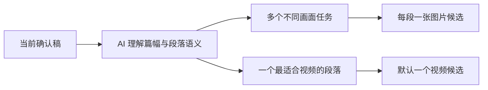

# T-854 前端旅程契约

大白话：图片不再固定只做一张，AI 要先看完整确认稿，再按篇幅和真正的画面任务挑出多个不重复段落，每段各做一张；视频因为成本更高，默认只做一个最值得表达的段落。



```frontend-journey-contract
{
  "schema": "frontend-journey-contract/v2",
  "task_id": "T-854",
  "journey": "从当前确认稿预填按篇幅生成多张图片候选或默认一条视频候选的请求",
  "entry": "当前项目稿面 → 编导输入框快捷按钮行",
  "watched_paths": [
    "frontend/src/fixtures/selectors/copilot.ts",
    "frontend/src/fixtures/selectors/index.ts",
    "frontend/src/features/copilot/ai-copilot-content.tsx",
    "frontend/src/features/copilot/ai-copilot-content.test.tsx",
    "frontend/tests/e2e/semantic-material-generation.spec.ts"
  ],
  "required_checks": [
    {"id": "AC-MATERIAL-BUTTONS", "test_id": "E2E-MATERIAL-GENERATE-COUNT-01"},
    {"id": "AC-IMAGE-MULTI-SEGMENT-PREFILL", "test_id": "E2E-MATERIAL-GENERATE-COUNT-01"},
    {"id": "AC-VIDEO-SINGLE-DEFAULT-PREFILL", "test_id": "E2E-MATERIAL-GENERATE-COUNT-01"},
    {"id": "AC-MATERIAL-NO-AUTO-SEND", "test_id": "E2E-MATERIAL-GENERATE-COUNT-01"}
  ],
  "required_conditions": ["confirmed-multi-paragraph-script", "image-multiple", "video-single-default", "minimum-window"],
  "viewports": [
    {"width": 1536, "height": 1024},
    {"width": 1024, "height": 768}
  ],
  "coherence_groups": [],
  "copy_guard": {"forbid_internal_ids": true},
  "states": [
    {"id": "ready", "visible": "生成图片素材 · 生成视频素材"},
    {"id": "image-prefilled", "visible": "按确认稿篇幅选择多个段落，每段各生成一张图片候选"},
    {"id": "video-prefilled", "visible": "默认只生成一个连续短视频候选以控制成本"}
  ],
  "actions": [
    {"from": "ready", "action": "点击生成图片素材", "to": "image-prefilled"},
    {"from": "ready", "action": "点击生成视频素材", "to": "video-prefilled"}
  ],
  "honesty": [
    "图片数量由 AI 根据当前确认稿篇幅、段落结构和实际画面需要判断，不在代码里写死固定张数",
    "视频默认只生成一个候选，只有用户明确要求时才增加",
    "点击只预填，不自动发送或产生费用",
    "用户可见话术不暴露工具名、内部类型或技术 ID"
  ]
}
```
