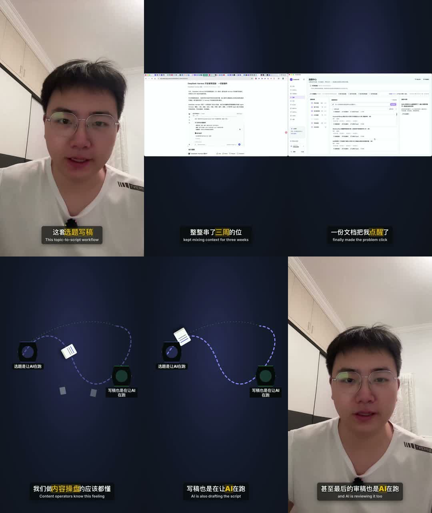

# T-858 单主语剪辑、编导方向与字幕重点词验收

> 日期：2026-08-16
> 阶段：4-build；等待用户确认修订短样片，未重渲整片、未出安装包。

## 大白话结论

第一版虽然做到了“人物只在素材窗缩小、结束后精确回位”，但用户明确指出这个策略本身很奇怪。
因此该版不再算通过证据。本轮改的是镜头语法：人物、横版素材、动态内容按口播节拍轮流接管画布，
同一时刻只保留一个主体。

## 用户反馈怎样落进正式产品

| 旧问题 | 本轮修复 |
| --- | --- |
| 素材/PPT 出现就自动把人物缩成居中或角落 PiP | 新导演合同只允许 `base / takeover`；正式新候选不再产出自动 PiP |
| 人物与主视觉同时争夺注意力 | `takeover` 期间主视觉和不透明静态承接层整体盖过人物 |
| 结束时靠人物放大动画“回位” | 模板删除素材窗与动态卡驱动的 `#th` 缩放、位移、圆角和回位 tween；结束帧直接揭示原全屏人物 |
| 横版素材太小且悬在上方 | 素材保持完整 `contain`，竖屏舞台改到画布中部；不裁切、不拉伸、不复制第二路动态视频 |
| 动态内容压在人物头顶 | 动态内容改为不透明独占 cutaway，并重新放到画布中部；人物在该窗完全不可见 |
| 旧候选可能仍含 `pip_bottom_left` | 契约只保留可读兼容；正式组装器统一输出 `hidden`，模板不再执行该旧字段的 PiP 动画 |
| 漏写导演 beat 时旧卡片/素材仍可能偷偷上屏 | `direction` 存在时每张卡片、每段非 `overlay` 主素材必须恰好出现一次；契约与 runner 拒绝漏拍/重拍，模板缺 beat 直接失败；明确辅助 overlay 不进入主视觉图，也不得驱动人物几何 |
| 组装器曾把素材 beat 擅自提前 | 现在纯透传 AI 编导时间线，不再改写 `startSec` |
| v4 横版录屏和两步动效仍像小卡片 | v5 录屏升级为全宽 `full_frame + hidden` 居中接管；竖屏动态步骤舞台从 460px 增至 720px，两节点放大并横向铺开 |

## 真实短样片

- 来源：T-838 的 157 秒真实生产时间线、本人真实口播源和两段真实横版录屏。
- 本次只截取 0–14 秒，1080×1920、30fps、420 帧，含原音、双语字幕、重点词和动态内容画面。
- 状态点：0.8 秒人物全屏；3.8/6.2 秒横版素材独占；8.2/10.2 秒动态内容独占；12.2 秒直接切回人物。
- 当前文件：`orchestrator/evidence/T-858/single-subject-14s-preview-v5.mp4`。
- 当前接触表：`orchestrator/evidence/T-858/contact-sheet-v5.jpg`。
- `unified-stage-14s-preview.mp4` 是被用户否定的旧策略；v2 仍透出人物、v3 动态画面位置偏上、v4 主视觉密度不足，均只保留为迭代证据，不作为通过版本。
- 重点词在视觉验收中使用逐项显式候选夹具；生产候选仍由 `video.subtitles` AI 输出，并走同一契约、runner、组装器和 renderer。

## 工程证据

- 红测先复现：旧契约接受 `pip + safe_overlay`；前端后续录屏产出 `pip_bottom_left`；模板生成素材窗驱动的人物缩放/回位。
- 聚焦测试通过：contract 16、ai-worker 11、frontend 9、backend 159，共 195 项；其中新增漏拍/重拍拒绝、辅助 overlay 与主视觉分层、模板 fail-closed、旧 PiP 仅可读兼容、竖屏动态主舞台密度测试。
- contract、ai-worker、backend、frontend 四包类型检查通过。
- physical boundary：无新增违规，存量 5 条保持基线。
- semantic boundary：通过；创作语义仍归 Skill/模型，代码只落实真实 ref、时间与安全边界。
- `git diff --check`：通过。
- v5 媒体探针：H.264/AAC、1080×1920、30fps、14.000 秒、420 帧。
- 独立复审 round 3/3：`PASS[REV:2521be715a0a]`，0 个未销账问题。
- 全局 `reconcile` 仍因仓库既有积债失败：BACKLOG 体积失控、多个历史任务 receipt 过期/旧表缺验收列、
  LED-027 既有并发门回归等共 105 项；T-858 的独立复审、物理边界、语义边界与聚焦测试本身通过。

## 未执行

没有重渲 157 秒整片，没有创建正式生产任务，没有出 macOS/Windows 安装包，没有推送或发布。
这些动作都等用户先确认 v5 的单主语镜头方向。
