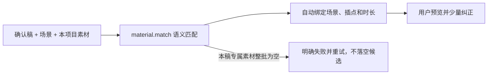

# T-867 BUILD 验证：恢复 AI 素材与分镜自动匹配

## 用户可见结论

“可选补充素材 · 8 个”不是产品本来要求用户逐条分镜，而是自动匹配链路的失败结果被当成了成功：

1. `material.match` 返回空数组仍能通过校验；
2. AI 已为当前项目选入或生成并采纳的素材，被统一标成“用户手动上传”；
3. 生成素材保存描述时裁掉了确认稿段落原文，只剩视觉方案；
4. 前端因此把这些未匹配项全部投进人工纠正区。

本次恢复为：AI 根据确认稿、场景、画面需求和素材描述自动匹配；用户只检查结果，需要时改绑少量
素材。存在本稿专属生成素材却整批匹配为空时，任务会诚实失败并允许重试，不再生成一个看似可确认、
实际要求用户完成 8 次分镜的候选。



## TDD 证据

### RED

- 动态 schema 接受本稿生成素材的空 `matches`；
- `addedByType=ai` 被投影成 `manual`；
- 生成素材名称暴露内部“当前确认稿绑定/版本”包装，描述缺失服务原文；
- 前端把 AI 项目素材渲染成逐条“选择场景”。

首次定向运行结果：`3 failed | 99 passed`。

### GREEN

```bash
pnpm --dir ai-worker exec vitest run src/prompt/templates/material-match.test.ts
pnpm --dir backend exec vitest run src/modules/ai-runtime/video-decisions-runner.test.ts src/modules/ai-runtime/asset-generate-runner.test.ts
pnpm --dir frontend exec vitest run src/features/production/video-decision-preview.test.tsx
```

结果：AI Worker `4 passed`；Backend `103 passed`；Frontend `13 passed`。

## 关键约束

- AI 来源从项目素材链接一路保留到模型清单和前端；
- 新生成素材描述保存“服务原文 / 画面职责 / 视觉方案”，名称只展示视觉方案；
- `material.match` Skill 明确逐项评估本项目 AI 素材，人工只纠正误配；
- 本稿绑定素材整批空匹配不得落候选；
- 不按文件名词表、关键词计分或字符串相似度做创作匹配；
- 不自动确认候选，不修改用户当前项目与既有方案。

## 回归范围

- Backend 全量：`2914 passed | 4 skipped`（修改前后的首次独立全量通过）；
- AI Worker 全量：`384 passed`；
- Frontend 全量：`3064 passed | 1 todo | 4 failed`，4 个失败均为范围外既有问题：1 个工具名不变量
  用例发现 2 个旧夹具键、2 个脚本上下文旧冻结清单用例、1 个缺项目测试夹具用例，共落在 3 个文件；
  本次生产预览定向 13/13 通过；
- Backend / AI Worker / Frontend typecheck：通过；
- `semantic-boundary-scan`：通过；
- `boundary-scan --quiet`：通过；
- `git diff --check`：通过。

## 明确未做

- 未调用真实模型或产生计费；
- 未自动重跑用户当前分场任务；
- 未确认候选或修改用户项目数据；
- 真机效果需安装包含本修复的新开发包后，由用户主动重新生成“AI 分场决策”验证。
