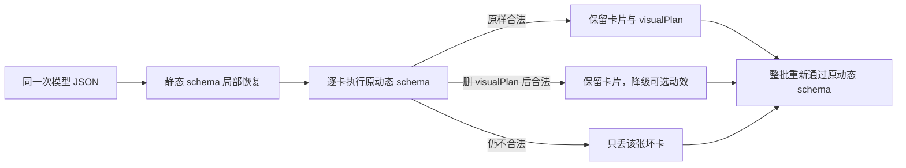

# T-868 BUILD 验证：video.cards 根级动态协议局部恢复

## 用户可见结论

用户本次错误与 T-865 的静态枚举越界不同：`video.cards` 的 JSON 字段都能通过基础 Zod schema，
但最终动态协议检查发现某张卡的 `sceneIdx/at` 或 `visualPlan` 动作/引用关系不合法，并只返回根级
`custom path=[]`。旧恢复器依赖具体字段路径，无法知道是哪张卡失败，因此文本兜底仍整批报错。

本次不放宽协议，也不猜模型本意。恢复链把每张卡重新交回原动态 schema：



## TDD 证据

### RED

命令：

```bash
pnpm --dir backend exec vitest run src/modules/ai-runtime/video-decisions-runner.test.ts -t 'T-868 RED'
```

结果：`1 failed | 90 skipped`。真实形状中 `grow` 错用 `opacity`、另有一张 `sceneIdx=9`；旧
`normalizeObject` 返回后，原动态 schema 仍为 `success=false`，与用户日志的根级 `custom` 一致。

### GREEN

```bash
pnpm --dir ai-worker exec vitest run src/nodes/structured-node.test.ts src/prompt/templates/video-decisions.test.ts src/prompt/creative-output-recovery.test.ts
pnpm --dir backend exec vitest run src/modules/ai-runtime/video-decisions-runner.test.ts
```

结果：AI Worker `37 passed`；Backend `91 passed`。

覆盖：

- generateObject 的同一响应携带可解析 JSON 时，直接局部恢复，模型调用仍为 1；
- 动作属性动态非法：只删除 `visualPlan`，保留卡片正文；
- `sceneIdx` 越界：只删除该张卡；
- 同批前后合法卡完整保留；
- 恢复结果重新通过原动态 schema；
- 未解析错误消息、未猜 role/动作、未放宽 schema、未增加模型请求。

补充回归：AI Worker 全量 `49 files / 385 tests passed`；AI Worker 与 Backend typecheck 通过；
`semantic-boundary-scan`、`boundary-scan --quiet`、`git diff --check` 通过。Backend 全量运行时多个与
本任务无关的数据库服务测试同时出现约 16 分钟级资源争用超时，已停止该失真运行；本次修改文件的
独立 Backend 回归稳定为 `91/91`，未把全量环境争用伪报为通过。

## 明确未做

- 未调用真实模型或产生计费；
- 未自动重跑用户当前失败任务；
- 未修改用户项目、候选或模型配置；
- 安装版需包含本修复的新本地开发包后，再由用户主动重试分场。
