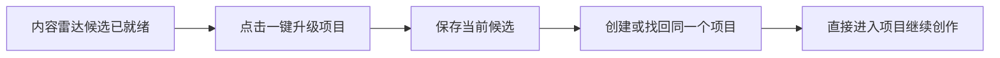

# T-870 前端旅程契约

大白话：内容雷达已经把逐字稿、拆解和改写初稿准备好后，用户只需一次明确点击，就能把这条选题直接变成项目并开始创作；网络重试也不会多建项目。



```frontend-journey-contract
{
  "schema": "frontend-journey-contract/v2",
  "task_id": "T-870",
  "journey": "从内容雷达已完成逐字稿的选题候选一次确认并直接进入项目",
  "entry": "内容雷达 → 已生成选题候选的作品详情",
  "watched_paths": [
    "backend/src/modules/candidate/candidate.repository.ts",
    "backend/src/modules/candidate/candidate.service.ts",
    "backend/src/modules/candidate/candidate.service.test.ts",
    "backend/src/modules/candidate/candidate.contract.test.ts",
    "frontend/src/features/intelligence/intelligence-workbench.tsx",
    "frontend/src/features/intelligence/intelligence-workbench.test.tsx",
    "frontend/tests/e2e/content-radar-one-click-project.spec.ts"
  ],
  "required_checks": [
    {"id": "AC-RADAR-UPGRADE-ACTION", "test_id": "E2E-RADAR-UPGRADE-01"},
    {"id": "AC-RADAR-UPGRADE-NO-SECOND-CONFIRM", "test_id": "E2E-RADAR-UPGRADE-01"},
    {"id": "AC-RADAR-UPGRADE-READBACK", "test_id": "E2E-RADAR-UPGRADE-01"}
  ],
  "required_conditions": [
    "unconfirmed-candidate",
    "regular-window",
    "minimum-window",
    "promotion-replay"
  ],
  "viewports": [
    {"width": 1536, "height": 1024},
    {"width": 1024, "height": 720}
  ],
  "coherence_groups": [],
  "copy_guard": {"forbid_internal_ids": true},
  "states": [
    {"id": "candidate-ready", "visible": "确认写入选题池 · 一键升级项目"},
    {"id": "promoting", "visible": "正在升级…"},
    {"id": "project-ready", "visible": "进入刚创建或已存在的同一项目"}
  ],
  "actions": [
    {"from": "candidate-ready", "action": "点击一键升级项目", "to": "promoting"},
    {"from": "promoting", "action": "保存候选并正式立项", "to": "project-ready"},
    {"from": "promoting", "action": "暂时失败", "to": "candidate-ready"}
  ],
  "honesty": [
    "只有来源、逐字稿和候选满足既有立项条件时才显示真实可用按钮",
    "点击本身就是用户确认，不再要求去选题中心二次确认",
    "失败时保留候选并允许重试，重复立项只返回原项目",
    "不自动批量创建项目，不跨账号，不绕过正式服务直接写库"
  ]
}
```
