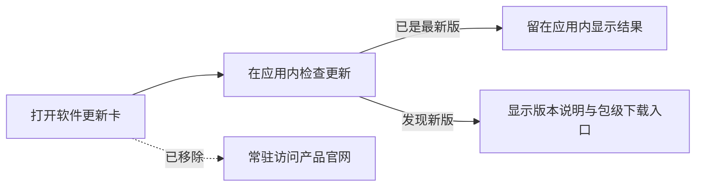

# T-871 BUILD 验证：移除设置页常驻产品官网入口

## 用户可见变化

设置 → 账户 → 软件更新中，不再显示“访问产品官网（查看最新版本与更新说明）”，卡片说明改为
“在应用内检查是否有新版”。“检查更新”按钮保持不变；只有确实检测到新版时，才继续显示当前包
既有的下载入口。



本次只收掉低价值常驻跳转，不修改包级更新 manifest、检查请求、版本比较、新版下载地址、人工反馈
或其他渠道链接。

## TDD 与回归证据

### RED

先把组件契约改为“常驻官网入口和官网引导文案均不存在”，旧实现失败：

```text
1 failed | 7 skipped
Received: data-slot="check-update-official-link"
```

### GREEN

```bash
pnpm --dir frontend exec vitest run src/features/settings/check-update-card.test.tsx
pnpm --dir frontend typecheck
pnpm --dir frontend exec playwright test tests/e2e/channel-public-links.spec.ts --project=e2e
node orchestrator/process/boundary-scan.mjs --quiet
```

结果：组件回归 `8/8`、类型检查通过、真实页面 E2E `1/1`，并在 `1440×900` 与 `1024×720`
两个窗口确认常驻官网入口不存在、页面无残留占位；人工反馈的包级链接仍正常，架构边界通过。

## 交付边界

- 未删除 `PACKAGE_WEBSITE_URL` 的包级配置能力，避免影响其他尚存消费方或后续渠道配置兼容；
- 未删除“发现新版”后的 `PACKAGE_DOWNLOAD_URL` 下载动作；
- 未重新打包、未安装、未发布、未修改生产 1.1 或渠道 manifest。
