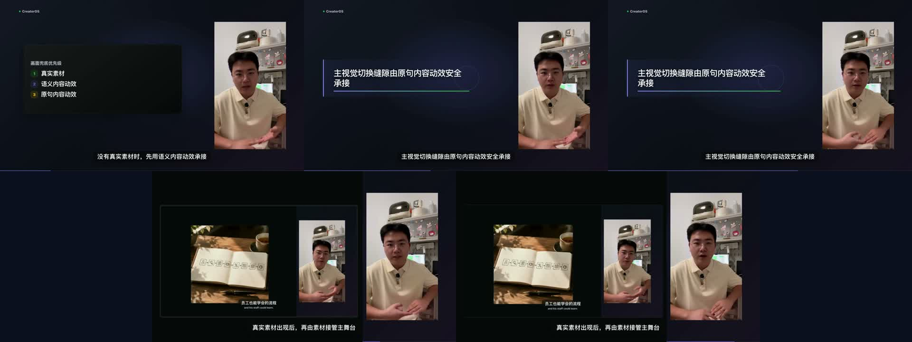

# T-876 横屏空舞台与无素材动效兜底验收

> 日期：2026-08-17
> 状态：代码与代表性真实时间线短样片已验证，尚未进入桌面安装包。

## 大白话结论

反复出现空屏的根因不是播放器，也不是素材没下载，而是旧逻辑只问“这个场景里有没有素材”。只要同一场
稍后出现过一张图或一段录屏，人物就会从场景开头起一直缩在右侧；素材真正出现前、两段素材之间或素材退出后，
左侧主舞台便会空出来。

本次改成按真实起止时间逐段判断，并固定三层兜底：优先显示语义匹配的真实素材；没有素材时由 AI 根据当前
口播生成信息卡/Scene Graph 内容动效。高级 Scene Graph 若没有通过结构或可溯校验，只降低为计数、条形生长、
逐项揭示等基础内容动效，不能退成静止卡片。横屏竖版人物始终稳定留在右侧，不再切到中央放大；上游即使
漏拍，渲染层也会把当前口播原句变成左侧内容动效。纯背景、角标或静止的右侧窄人物不再算“有画面”。

## 修复点

| 层 | 旧行为 | 新行为 |
| --- | --- | --- |
| AI 总导演 | 只禁止 beat 重叠，允许首尾和中间留洞 | beat graph 必须首尾连续覆盖完整口播；无素材时必须生成可溯内容动效 |
| 信息卡动效 | Scene Graph 非法或被可溯门剔除后可能只剩未显式声明动画的卡片，并被误报为“无内容动效” | 每张新卡都持久化 motion；高级图形失败只降级到基础内容动效，静止卡片禁止晋级 |
| 确定性修片 | 最长允许约 7 秒无有效视觉 | 只保留正常切镜边界容差；任何非开场短场景也会被检查并自动补卡 |
| 横屏渲染 | 按场景一次性决定人物在右侧还是主体位 | 人物稳定留在右侧；按 card/B-roll 的真实时间窗切换左侧内容，空洞由可溯原句动效补齐 |
| 剪辑 Skill | 没有明确禁止“场景稍后有素材，所以整场缩人” | 永久门改为逐时间窗验收，固定真实素材→语义动效→可溯原句动效降级链，并禁止横屏把竖版人物居中放大 |

## 真实画面验证

- 失败来源：`/Users/zyongzhu/CreatorOS/workspaces/ai-task-5b4809a2-1507/out/final.mp4`，94.698667 秒，1920×1080、30fps。
- 代表性预览：从该成片裁取真实人物与真实画面，使用生产模板渲染 12 秒时间线。
- 0–4 秒：无真实素材，语义清单逐项揭示；人物只作为不抢主语的辅助层。
- 4–8 秒：模拟上游漏拍；人物几何保持右侧不变，左侧主舞台用当前口播原句的文字运动承接，不出现居中人物。
- 8–12 秒：真实素材进入主舞台，人物按生产安全分屏让位。
- 输出：H.264、1920×1080、30fps、12.000 秒；HyperFrames 运行时 0 错误并完成 360 帧渲染。
- 接触表与 2s/5s/7.5s/9s/11s 五张独立抽帧均无“大面积空舞台 + 右侧窄人物”。

## 自动验证

- 后端模板、AI 决策与执行器：195 项通过。
- 后端类型检查：通过。
- AI Worker 提示词回归：11 项通过；`video.cards` v7 明确要求每张卡必填基础动效意图。
- AI Worker 类型检查：通过。
- 新增红测在实现前分别证明：短场景空洞未阻断、方向尾部可留空、横屏人物没有轻推镜；实现后全部转绿。
- HyperFrames 静态检查仍报告生产模板既有的本地系统字体声明，以及这份无声裁剪样片的 `muted` 建议；运行时、布局、运动检查与实际 MP4 渲染未被阻断。本任务不把这些既有 lint 项伪报为通过。

## 尚未包含

- 没有重写用户原来的 94.7 秒成片，也没有修改任何 CreatorOS 账号/项目数据。
- 没有在本任务中构建或安装桌面包；需进入安装包后再用同一项目实机重跑最终验收。
