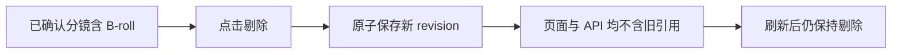

# T-881 前端旅程契约

大白话：用户在已经确认的分镜里剔除一段 B-roll 后，系统必须先保存一份新的当前分镜，再允许继续
制作；刷新页面也不能把旧素材带回来，旧渲染更不能覆盖新版本。



```frontend-journey-contract
{
  "schema": "frontend-journey-contract/v2",
  "task_id": "T-881",
  "journey": "从已确认分镜剔除真实 B-roll，写后读并刷新确认旧素材不再出现",
  "entry": "项目 → 制作视频 → 已确认分镜与自动 B-roll 候选",
  "watched_paths": [
    "contract/src/operations/production.ts",
    "backend/src/modules/production/production.service.ts",
    "backend/src/modules/production/production.transport.ts",
    "backend/src/modules/ai-runtime/video-decisions-runner.ts",
    "frontend/src/features/production/production-workbench.tsx",
    "frontend/src/features/production/assemble-video-render-props.ts",
    "frontend/tests/e2e/production-broll-remove.spec.ts"
  ],
  "required_checks": [
    {"id": "AC-BROLL-REMOVE-PERSIST", "test_id": "E2E-BROLL-REMOVE-01"},
    {"id": "AC-BROLL-REMOVE-READBACK", "test_id": "E2E-BROLL-REMOVE-01"},
    {"id": "AC-BROLL-REMOVE-REFRESH", "test_id": "E2E-BROLL-REMOVE-01"}
  ],
  "required_conditions": [
    "confirmed-storyboard",
    "real-video-asset",
    "regular-window",
    "minimum-window",
    "refresh-readback"
  ],
  "viewports": [
    {"width": 1536, "height": 1024},
    {"width": 1024, "height": 720}
  ],
  "coherence_groups": [],
  "copy_guard": {"forbid_internal_ids": true},
  "states": [
    {"id": "confirmed-with-broll", "visible": "已确认分镜与可剔除素材"},
    {"id": "removing", "visible": "剔除动作处理中"},
    {"id": "removed", "visible": "已从当前分镜移除并保存"}
  ],
  "actions": [
    {"from": "confirmed-with-broll", "action": "点击剔除", "to": "removing"},
    {"from": "removing", "action": "服务端原子保存并回读", "to": "removed"},
    {"from": "removed", "action": "刷新页面", "to": "removed"}
  ],
  "honesty": [
    "写入失败时不能把按钮伪装成已删除",
    "删除只作用于当前分镜版本，不物理删除素材库原文件",
    "旧成片保留为历史，但不得覆盖当前版本",
    "测试使用隔离账号和真实 mp4，不修改用户项目"
  ]
}
```
