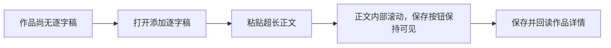

# T-893 前端旅程契约

大白话：用户粘贴再长的逐字稿，正文只在弹窗中间区域滚动，底部“保存逐字稿”始终留在窗口内；
保存后弹窗关闭，作品详情立即回显这份逐字稿，用户可以继续生成选题。



```frontend-journey-contract
{
  "schema": "frontend-journey-contract/v2",
  "task_id": "T-893",
  "journey": "在内容雷达最小窗口粘贴超长逐字稿并通过始终可见的操作区保存",
  "entry": "内容雷达 → 尚无逐字稿的真实采集作品详情",
  "watched_paths": [
    "ai-worker/src/runtime/agent-runtime.ts",
    "backend/src/modules/intelligence/topic-preview-runner.ts",
    "frontend/src/server/persistence-client.ts",
    "frontend/src/features/intelligence/intelligence-workbench.tsx",
    "frontend/src/features/intelligence/intelligence-workbench.test.tsx",
    "frontend/tests/e2e/content-radar-one-click-project.spec.ts"
  ],
  "required_checks": [
    {"id": "AC-TRANSCRIPT-DIALOG-SAVE", "test_id": "E2E-TRANSCRIPT-DIALOG-01"}
  ],
  "required_conditions": [
    "real-collected-item",
    "long-transcript",
    "regular-window",
    "minimum-window",
    "write-readback"
  ],
  "viewports": [
    {"width": 1536, "height": 1024},
    {"width": 1024, "height": 720}
  ],
  "coherence_groups": [],
  "copy_guard": {"forbid_internal_ids": true},
  "states": [
    {"id": "transcript-empty", "visible": "添加逐字稿"},
    {"id": "long-transcript-editing", "visible": "逐字稿正文 · 保存逐字稿"},
    {"id": "transcript-saved", "visible": "替换逐字稿 · 生成选题候选"}
  ],
  "actions": [
    {"from": "transcript-empty", "action": "打开并粘贴超长正文", "to": "long-transcript-editing"},
    {"from": "long-transcript-editing", "action": "滚动正文并点击保存逐字稿", "to": "transcript-saved"}
  ],
  "honesty": [
    "正文超出限制时禁用保存并显示真实原因",
    "弹窗只限制布局，不截断或改写用户正文",
    "测试使用隔离账号与公开 RSS 作品，不读写用户真实账号",
    "后台改写失败必须保存真实失败终态，不用假候选掩盖"
  ]
}
```
