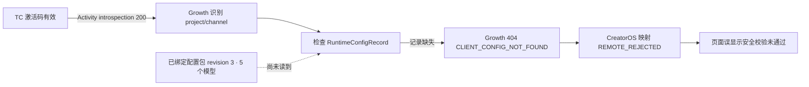

# T-899 TC 流量中心渠道模型配置诊断

日期：2026-08-19  
范围：只读核对本机 TC 流量中心加密日志、渠道模型缓存、Growth 生产日志与脱敏配置目录；未修改激活码、用户模型、Growth 数据或线上配置。

## 结论

用户不应该输入模型。当前 TC 激活码已经有效激活，Growth 也已经为该激活渠道绑定了包含 5 个模型的有效 `productConfig` 包。失败发生在 Growth 读取已绑定配置包之前：该渠道缺少非官方渠道读取契约要求的 `RuntimeConfigRecord(kind=channel)`，`get_current_bundle()` 先执行 `_validate_directory()`，因此返回 HTTP 404 / `CLIENT_CONFIG_NOT_FOUND`，根本没有进入配置包解析、签名或托管凭据领取。

CreatorOS 把这个未识别的 Growth 404 归并成 `CLIENT_CONFIG_REMOTE_REJECTED`，设置页再统一显示为“本地模型正在使用 · 渠道配置安全校验未通过”。所以页面看起来像验签失败或需要用户手填模型，实际是 Growth 渠道开通数据不完整，加上客户端错误文案分类不准确。

## 证据

### 本机 TC 流量中心

- `2026-08-19T10:11:01Z`：`licensed=true / status=active`，证明激活成功。
- `2026-08-19T10:11:18Z`：两次配置同步均返回 `CLIENT_CONFIG_REMOTE_REJECTED`，不是本机“未配置模型”。
- 当前安全缓存 locator：
  - `projectKey=creatoros`
  - `channelRef=partner-p501444c-8dc8404bc0`
  - `clientId=creatoros.desktop`
- 旧缓存曾在本轮启动被隔离为 `security_error`；随后在线刷新仍稳定收到 Growth 拒绝，因此清缓存或重装不能解决线上 404。

### Growth 生产运行态

- 同一时间窗 Activity ticket introspection：HTTP 200。
- `GET /api/client-config/bundles/current`：HTTP 404；关联请求完成码为 `ROUTE_NOT_FOUND`，服务实现对应的领域错误为 `CLIENT_CONFIG_NOT_FOUND`。
- 当前激活渠道 `partner-p501444c-8dc8404bc0`：
  - 渠道目录 `active`；
  - 已绑定配置包 `PCP-43002A2E32ED418D`；
  - 配置包 `active / currentRevision=3`；
  - `productConfig` locator 与客户端一致，payload 内有 5 个模型；
  - `RuntimeConfigRecord` 缺失。
- TC 包清单中的预期渠道 `partner-p501444c-tc-flow-center` 也存在 active 渠道目录，但没有配置包绑定，也没有 `RuntimeConfigRecord`。当前真实激活票据使用前一条随机后缀渠道；本次 404 的直接原因仍是该真实渠道缺运行记录，而不是配置包不存在。

## 代码路径

Growth `ClientConfigApplicationService.get_current_bundle()` 的顺序是：

1. 内省 Activity ticket；
2. 解析 `projectKey/channelRef`；
3. 调用 `_validate_directory()`，要求 active project、active channel 和非官方渠道 `RuntimeConfigRecord(kind=channel)` 同时存在；
4. 通过后才读取 `ChannelProductConfigBinding` 与 `ProductConfigPackage`。

当前生产数据在第 3 步失败，因此第 4 步已存在的配置包无法生效。现有配置包测试 fixture 预先种入了 `RuntimeConfigRecord`，没有覆盖“渠道目录 active + 配置包已绑定 + 运行记录缺失”的真实开通组合。

## 根治范围

### Growth（主修）

1. 渠道配置包绑定/开通必须原子形成完整 runtime closure：active 渠道目录、`RuntimeConfigRecord(kind=channel)`、配置包 binding 和当前 revision 缺一不可；写后必须按真实 bundle 读取路径回读。
2. 对已经绑定配置包但缺运行记录的存量渠道做有界审计与补齐；不得只修当前 TC 单条数据，也不得绕过 lifecycle/停销/终止语义。
3. 配置包绑定操作在缺 runtime closure 时必须拒绝成功或同步物化运行记录，不能继续留下“后台显示已绑定、客户端永远 404”的半套状态。
4. 增加回归：真实渠道目录 + 配置包绑定但缺 runtime 先红；修复后 `ticket → bundle → managed credential` 完整读回，并覆盖停销/终止状态。

### CreatorOS（次修）

1. 识别 Growth `CLIENT_CONFIG_NOT_FOUND`，不要把所有未识别 404 统称为“安全校验未通过”。
2. 对渠道权益存在但配置开通不完整，显示“渠道模型配置尚未完成，请联系渠道方”，不要引导用户手填本地模型。
3. 保留 fail-closed：不能因为 Growth 配置缺失而猜模型或回退官方密钥。

## 已排除

- 激活失败：本机 verdict 已为 active。
- Activity ticket/权限失败：生产内省 HTTP 200。
- 配置包不存在：真实激活渠道已有 active revision 3，含 5 个模型。
- Ed25519 keyId 或 bundle 签名失败：请求在 bundle 生成与签名前已被 runtime directory 门禁 404。
- T-894 的 OmniHi Key 分页问题：本次尚未进入 managed credential 端点；T-181 的分页修复已在线。
- 用户本地模型未填写：这是故障后的回退表现，不是根因。

## 当前状态

诊断完成，尚未修改 Growth 或 CreatorOS 产品代码，也未写入生产数据。让当前用户恢复需要先修 Growth 的渠道 runtime closure，并对受影响存量 binding 做安全补齐；仅重装、重输激活码、清缓存或要求用户手填模型都不能根治。
