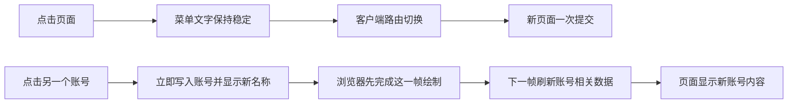

# T-912 页面与账号切换旅程

## 用户能感受到的结果

- 点击侧栏页面时，菜单文字始终保持原名称，不再改成“打开中”或闪烁。
- 页面继续沿用 Next.js 客户端路由；服务端内容返回后一次性提交，不增加人为等待层。
- 切换抖音号时，新账号名称先立即显示；下一帧再刷新依赖账号的页面数据。
- 连续快速切号时，取消尚未执行的旧刷新，只刷新最后一次选择；组件离开页面后也不执行遗留刷新。

## 验收旅程

| ID | 操作 | 通过条件 |
| --- | --- | --- |
| E2E-T912-01 | 在首页、定位中心、内容雷达、选题、项目、知识库之间反复切换 | 链接文字不出现“打开中”；地址与激活态正确；主内容可见；正常和最小窗口均无横向溢出 |
| E2E-T912-02 | 在两个真实账号之间切换 | 账号名称在刷新前已经更新；随后页面数据归属新账号；没有两次整页刷新 |
| E2E-T912-03 | 快速连续选择不同账号后离开组件 | 只执行最后一次刷新；卸载后不执行遗留刷新 |

## 性能判读

本机安装包服务端热态全页请求实测：常用页面大多约 14–30ms，首轮较重页面约 45–117ms；独立 Chromium 的侧栏点击到新地址与主内容可见约 42–101ms。因此本次根因不是数据库持续慢，而是 T-909 新增的人工等待态和账号切换同帧强制刷新放大了等待感。

