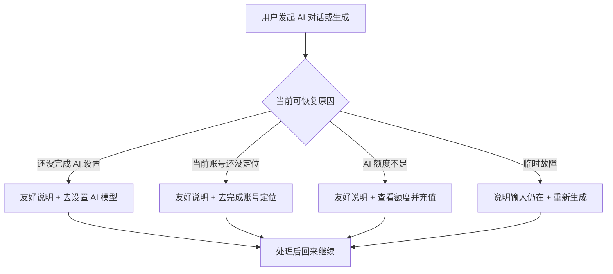

# T-913 AI 不可用时的恢复旅程

## 用户能感受到的结果

- AI 没有开始生成时，不再只看到“出错了，请重试”，而是看到一句原因和一个最合适的下一步。
- 需要完成 AI 设置时，按钮直接打开“模型配置”，不再先落到账户页让用户自己找。
- 当前账号还没有定位时，按钮直接打开定位中心；刚才发出的内容仍保留在本次对话中，可处理后继续。
- 产品自带的 AI 额度不足时，按钮打开真实额度页面；用户自己配置的 AI 不可用时，只引导检查设置。
- 界面只说用户要做什么，不出现激活码类型、渠道密钥、Growth、authority、供应商错误码等内部信息。



```frontend-journey-contract
{
  "schema": "frontend-journey-contract/v2",
  "task_id": "T-913",
  "journey": "AI 不可用时按真实原因给出一条明确恢复路径",
  "entry": "CreatorOS AI 助手、定位生成与内容雷达选题生成入口",
  "watched_paths": [
    "frontend/src/lib/ai-error-humanize.ts",
    "frontend/src/lib/ai-error-humanize.test.ts",
    "frontend/src/features/copilot/ai-copilot-content.tsx",
    "frontend/src/features/copilot/ai-copilot-interactions.test.tsx",
    "frontend/src/features/copilot/chat-distill-card.tsx",
    "frontend/src/features/copilot/chat-script-draft-card.tsx",
    "frontend/src/features/copilot/chat-publish-package-card.tsx",
    "frontend/src/features/copilot/chat-generate-card.tsx",
    "frontend/src/features/copilot/chat-douyin-share-card.tsx",
    "frontend/src/features/intelligence/intelligence-workbench.tsx",
    "frontend/tests/e2e/ai-recovery-guidance.spec.ts"
  ],
  "required_checks": [
    {"id": "AC-AI-MODEL-SETTINGS", "test_id": "E2E-T913-01"},
    {"id": "AC-AI-POSITIONING", "test_id": "E2E-T913-02"},
    {"id": "AC-AI-CREDITS", "test_id": "E2E-T913-03"},
    {"id": "AC-AI-UNKNOWN-RETRY", "test_id": "E2E-T913-04"},
    {"id": "AC-AI-COPY-SAFE", "test_id": "E2E-T913-05"}
  ],
  "required_conditions": [
    "regular-window",
    "minimum-window",
    "managed-ai-credits",
    "user-configured-ai",
    "positioning-missing",
    "unknown-transient-error"
  ],
  "viewports": [
    {"width": 1280, "height": 720},
    {"width": 900, "height": 600}
  ],
  "coherence_groups": [
    ["model-setup", "settings-model-highlight"],
    ["positioning-missing", "positioning-center"],
    ["managed-credit-missing", "secure-credit-center"]
  ],
  "copy_guard": {"forbid_internal_ids": true},
  "states": [
    {"id": "model-setup", "visible": "完成 AI 设置后继续"},
    {"id": "positioning-missing", "visible": "先完成账号定位"},
    {"id": "managed-credit-missing", "visible": "AI 额度需要补充"},
    {"id": "temporary-error", "visible": "这次没有生成成功"}
  ],
  "actions": [
    {"from": "model-setup", "action": "点击去设置 AI 模型", "to": "settings-model-highlight"},
    {"from": "positioning-missing", "action": "点击去完成账号定位", "to": "positioning-center"},
    {"from": "managed-credit-missing", "action": "点击查看额度并充值", "to": "secure-credit-center"},
    {"from": "temporary-error", "action": "点击重新生成", "to": "retrying"}
  ],
  "honesty": [
    "只在后端明确返回受管额度不足时展示额度入口",
    "用户自配模型的配置、鉴权或余额问题统一进入模型设置，不假装能够代充值",
    "定位入口只进入真实定位中心，不用假按钮或假完成态",
    "未知故障不猜原因，保留重试动作",
    "不向用户展示激活码类型、渠道配置或服务方内部名词"
  ]
}
```

## 验收旅程

| ID | 操作 | 通过条件 |
| --- | --- | --- |
| E2E-T913-01 | AI 对话返回模型未配置或凭据不可用 | 显示“完成 AI 设置后继续”；唯一主动作直达 `/settings?highlight=text-model` |
| E2E-T913-02 | AI 对话或内容雷达返回定位缺失 | 显示“先完成账号定位”；按钮直达 `/positioning`，不是无动作的警告文字 |
| E2E-T913-03 | AI 对话返回受管额度不足 | 显示额度恢复卡；只出现真实额度按钮，不出现模型设置或重试 |
| E2E-T913-04 | AI 对话返回未知临时错误 | 不猜配置或额度原因；说明本轮未完成并提供真实重新生成按钮 |
| E2E-T913-05 | 在正常与最小窗口检查四类恢复卡及相似 AI 入口 | 无横向溢出；不出现激活码类型、Growth、authority、供应商名、API Key 或机器错误码 |
