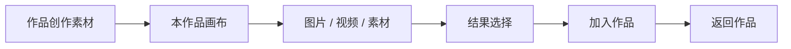

# T-994 创作画布与作品素材旅程

用户从作品的“创作素材”进入该作品画布，选择图片、视频或已有素材，能看见保存和结果归属，明确保留成果或加入作品，再安全返回。



```frontend-journey-contract
{
  "schema": "frontend-journey-contract/v1",
  "task_id": "T-994",
  "journey": "从作品用料进入账号隔离画布，创作、选择结果并安全返回",
  "entry": "作品的创作素材区域与账号画布库",
  "watched_paths": [
    "frontend/src/features/creative-canvas/canvas-editor.tsx",
    "frontend/src/features/creative-canvas/canvas-library.tsx",
    "frontend/src/features/creative-canvas/canvas-asset-picker.tsx",
    "frontend/src/features/creative-canvas/infinite-canvas.tsx",
    "frontend/src/features/creative-canvas/infinite-canvas-node.tsx",
    "frontend/src/features/draft-workbench/draft-workbench-page.tsx",
    "frontend/tests/e2e/creative-canvas.spec.ts"
  ],
  "required_checks": [
    {"id":"AC-CANVAS-PROJECT-ENTRY","test_id":"E2E-T994-01"},
    {"id":"AC-CANVAS-SAFE-RETURN","test_id":"E2E-T994-02"},
    {"id":"AC-CANVAS-RESULT-ACTIONS","test_id":"E2E-T994-03"},
    {"id":"AC-CANVAS-ACCOUNT-SCOPE","test_id":"E2E-T993-01"},
    {"id":"AC-CANVAS-MEDIA-PREVIEW","test_id":"E2E-T993-06"}
  ],
  "required_conditions": [
    "regular-window",
    "narrow-window",
    "project-scoped-list",
    "account-isolation",
    "empty-assets",
    "save-conflict",
    "result-link-retry"
  ],
  "viewports": [
    {"width":1536,"height":1024},
    {"width":1024,"height":768}
  ],
  "coherence_groups": [
    ["project-scoped-list","canvas-project-attribution","return-to-same-project"],
    ["result-preview","retain-once","link-to-selected-project"]
  ],
  "states": [
    {"id":"empty-canvas","visible":"从一个画面开始"},
    {"id":"result-preview","visible":"最近结果"},
    {"id":"save-conflict","visible":"画布已在其他窗口更新"}
  ],
  "actions": [
    {"from":"project-scoped-list","action":"创建作品画布","to":"empty-canvas"},
    {"from":"result-preview","action":"保留到素材库","to":"retained"},
    {"from":"retained","action":"加入作品","to":"linked"},
    {"from":"save-conflict","action":"重新载入","to":"reloaded"}
  ],
  "honesty": [
    "无素材时显示真实空态，不虚构素材",
    "生成结果需要用户主动保留或加入作品",
    "保存冲突时不离开画布，也不伪称已保存"
  ]
}
```
