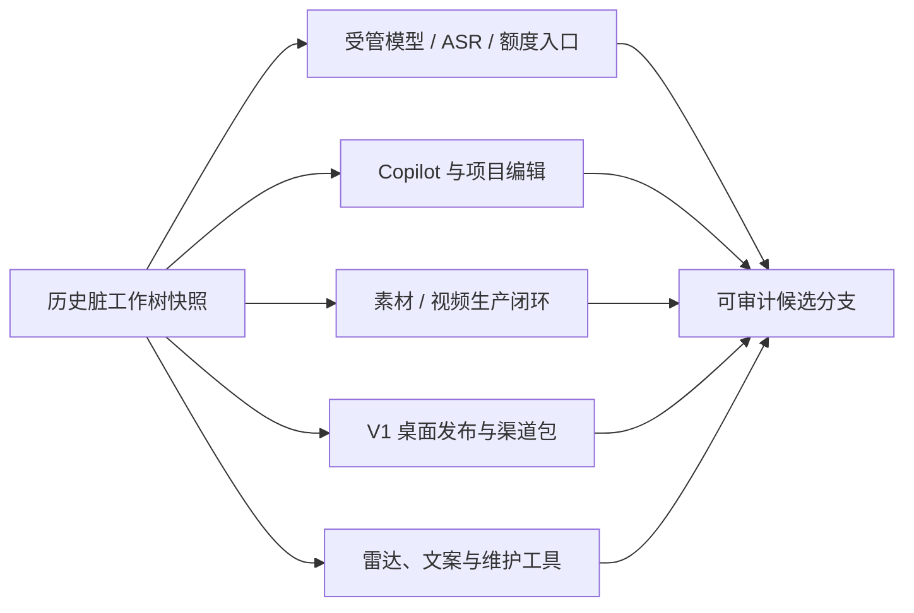

# T-728 历史脏工作区保全与归类证据

日期：2026-08-08
候选分支：`codex/v1.0-candidate`
快照基线：`2cb4a08c0d0e23a16622ae894584d994be242d12`

## 1. 可恢复快照

原工作区清点结果为：`252` 个 tracked changed、`230` 个 untracked、`0` 个 staged；tracked diff 为 `17,343` 行新增、`5,976` 行删除。任何分类或提交前，已把工作树保存到项目外恢复目录：

`/Users/zyongzhu/.codex/creatoros-v1-recovery.WdNj0F`

| 证据 | SHA-256 |
| --- | --- |
| `unstaged.diff` | `f99f3876d4524bd2b4e474b29eaa5ab53a6ae4bee47070aa48cd785f8f16836f` |
| `staged.diff`（空，证明初始无暂存改动） | `e3b0c44298fc1c149afbf4c8996fb92427ae41e4649b934ca495991b7852b855` |
| `untracked.tar` | `d7aa0530475b3523fc9c8615a9e1a3c1bdc8ed63abe390a8897c79dcd334e68e` |

恢复目录当前约 `125 MiB`。工作区内约 `64 MiB` 的 PDF/浏览器/视频审计临时输出没有入库，已原样移动到 `workspace-tmp/`；Rust 编译占位物移动到 `rust-test-placeholders/`。

## 2. 秘密扫描

对全部 `482` 个 tracked-changed/untracked 文件执行了文件名与内容规则扫描。没有发现私钥标记或可识别的生产密钥。命中项只有：

- 3 个测试 fixture 的通用 key/token 赋值：`backend/src/modules/llm/resolve.test.ts`、`backend/src/modules/multimodal/resolve.test.ts`、`frontend/scripts/desktop/notarize.test.mjs`；
- 1 个预期公开的 updater 信任根：`frontend/branding/trust/creatoros-update-root-20260805.pub.pem`。

渠道 JSON 只含公开业务 URL、模型目录和不可变包身份；不含激活码、配置 ticket、模型 Key、签名私钥或 Apple 凭据。

## 3. 逻辑提交归类

| 提交 | 归属 |
| --- | --- |
| `6f9c7934` | v3 ticket、受管模型/ASR、Growth 用户额度入口 |
| `7f121821` | Copilot、定位访谈、脚本局部修改/附件/版本、论点骨架退役 |
| `e28a30b6` | 素材语义决策、视频生产闭环、导出隔离与全量分页 |
| `1f964424` | `1.0.0` 版本、macOS 签名公证/真启动门、渠道包工厂 |
| `e30a4b7c` | 内容雷达异步选题自动续接与重试 |
| `d1a0b945` | 用户指南和营销稿同步直写稿链路 |
| `8479828a` | 内置课程与引导文案包品牌中性化 |
| `feeda4f8` | 只清本机激活态、保留业务数据的恢复工具 |

控制面、最终 Gate 与发布报告在后续独立提交中收口。以上提交均未包含 `tmp/`、本机编译占位物、私钥或真实一次性渠道码。
