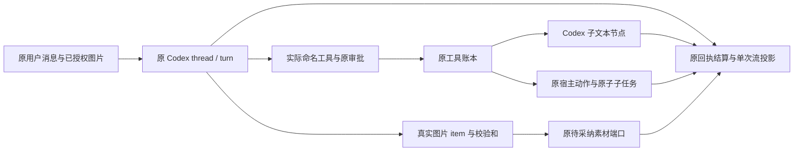

# T-1238 Codex 编导与工具闭环证据

本记录是隔离工作树的当场测试证据，不是账户真机 E2E。工作树：`/Users/zyongzhu/.codex/worktrees/codex-text-image/Thirdspace-creator`。全部下列 Vitest 执行均显式 `--retry 0 --testTimeout 120000 --hookTimeout 120000`。

Codex 编导沿用原工具的权限、审批、任务归属和账本；子文本节点只取得 Codex execution spec。当前偏好切换 Pi 且没有 API key，已创建 Codex 父任务的真实原子子任务仍冻结 Codex。

## 当场通过

| 范围 | 文件 | 结果 / 执行时间 |
| --- | --- | --- |
| 编导目录精确 tuple、效果与 Workbench 冻结 descriptor | `contract/tests/codex-assistant-tool-catalog.test.ts` | 23 PASS；19:23:10 |
| 前端原附件字节冻结、真实 SDK envelope、聊天 API 图片缺失/跨组拒绝 | `frontend/src/server/chat-model-message-snapshot.test.ts`、`frontend/src/app/api/chat/route.test.ts` | 2 文件 63 PASS；19:28:28 |
| 原宿主提交、冻结父引擎、混合工具账本、子模型身份、Workbench 原回执、原生图片 item 与真实素材归属、旧 Pi hooks | `backend/src/modules/execution/execution-codex-chat-tool.test.ts`、`execution-chat-model-identity.service.test.ts`、`workbench-plan-history.test.ts`、`backend/src/modules/ai/external-chat-turn.service.test.ts`、`backend/src/modules/execution/execution-chat-hooks.service.test.ts` | 5 文件 102 PASS、0 SKIP；19:42:44 |
| 图片 SDK7 data envelope 视觉预留、原摘要幂等、非图片不能绕预算；真实探针同尺寸 1414662 字节 / 输出 65536 / 总预算 1000000 可入场、冻结预算不能改 | `backend/src/modules/execution/execution-generation-ports.service.test.ts` | 3 PASS；19:46:15 |
| Codex durable 未确认重试关闭，Pi 原授权保留 | `ai-worker/src/execution/durable-generation-model.test.ts` | 4 PASS；19:38:32 |
| 真 `createCodexProviderModel` 与 SDK `generateText` 消费者的最后 bind 确认丢失，只读原 call/thread/turn 与 settled 原回执回放 | `ai-worker/src/execution/durable-codex-provider.test.ts` | 1 PASS；19:40:27；app-server 边界模拟 |
| 原生聊天 unknown 回合按严格名单恢复原 hooks/draft 后只读原 thread，图片附件与图片回收 | `ai-worker/src/execution/codex-external-chat-native-run.test.ts` | 3 PASS；19:42:07；app-server 边界模拟 |
| 最终 Worker 联合回归（上述子集合不可重复相加） | `external-chat-worker-run.test.ts` 13、`external-chat-tools.test.ts` 8、`codex-external-chat-native-run.test.ts` 3、`codex-acp-worker-run.test.ts` 16、`codex-acp-policy.test.ts` 11、`external-chat-recovery.test.ts` 4、`durable-generation-model.test.ts` 4、`durable-codex-provider.test.ts` 1 | 8 文件 60 PASS、0 SKIP；19:44:29 |
| Worker 类型检查 | `pnpm --dir ai-worker exec tsc --noEmit` | 当场退出 0；19:44:29 启动 |

恢复名单消费者 `external-chat-recovery.test.ts` 4 PASS 包含：只按后端证明名单恢复、完成 hooks 不重复模型、原父全部 restore 后再读子模型、外来 ACK 拒绝。ACP 原官方累计 `thread/tokenUsage/updated` 用量映射及预算取消保留原回合事实；旧 ACP 兼容测试保留。实时累计用量不拿上下文 `used` 当费用。

恢复代理后续补严格已结算原父 ACK 回放名单，本代理只将 identity scope 接 pending / settled proof union；必须已有 Codex identity，无身份或换身份仍拒绝。原 identity 文件 11 测试在 19:49:27 增量重跑 PASS；真实公共 ChatWorker 已结算 ACK 回放链路由恢复代理独占实现与验证，以其报告为准。

## 红测与限制

- Codex 普通 `connection closed` 原返回 retry_wait 的两条红测确实发生，修后 unknown、原 call 只读恢复。**没有**证明 `HOST_PORT_TIMEOUT` 原能自动重发，也不将其记录为生产重发事故。
- `asset.classify` 300000 字节 SDK7 图片 data envelope 在真实 reservation 端口原抛预算不足，红 1 / 绿 2。完整图片仍参与不可变请求摘要；计量只遮去传输字节，沿用每图 65536 的原视觉预留策略。该数是预留策略，不能冒称实际计费上界。
- 启动与结果未知均不得新造 turn 或不确定自动重发。未知 root 不自行猜测子工具；只消费后端核验原准备、身份、绑定的 named checkpoint 名单。
- 真账户文本/生图/public asset.generate 由主线程执行，本文件未代其补写真机 PASS。public 图片理解第三轮真账户已 succeeded，绿圆真实描述与原素材保存见 docs/verification/t1238/public-image-understanding-results-third.json；前两失败保留。
- 主线程已只读原 PGlite payload，确认失败图片请求的 base64 被旧算法当文本导致预算拒绝；`docs/verification/t1238/public-image-understanding-budget-second.json`、`public-image-understanding-binding-second.json` 是原失败证据。修复后 intent003 真账户执行已 succeeded，原 task/exec 的 state/results-third.json 回执保留。
- 19:28:28 `node tools/timeout-policy/verify.mjs` 退出 1，静态扫描保留 vendor reference editors 与其它既有短超时诊断；其随后节点/contract/worker/backend/frontend/MCP 分组通过。不增豁免，不写全绿。
- 旧checkpoint四条原请求号/幂等fixture失败保留；准确原单文件当场红24项20PASS/4FAIL→仅fixture请求号按task.id隔离→完整24PASS/0SKIP，证据见docs/verification/t1238/checkpoint-original-{recheck,fixture-fixed}.txt。同请求重投、水位、unknown及ACK断言和生产保护保留，不能拿其它26/31项代签。其它原编译/旧重试失败留存，最终类型和总Gate见GATES.md。
- 本代理最后一轮 backend 类型检查未报告本代理文件错误；退出 2 来自并行恢复代理新 `codex-read-recovery.integration.test.ts` 三处类型错误（宿主 now/nextId 与 effect 推断），已回传 owner 修复。不能据此写 backend 全类型检查 PASS。
