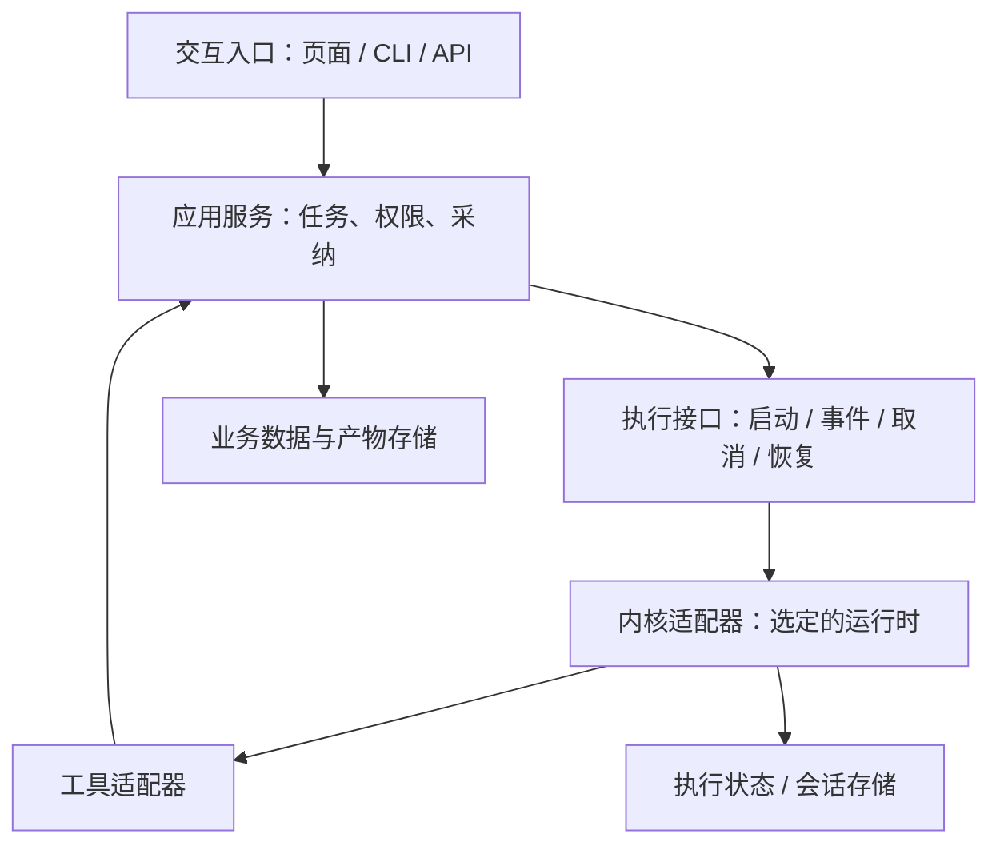

# Agent 项目的初始化架构设计

仅在新建 Agent 产品、首次接入或替换执行内核时读取。CONTRACT 做决定，Task Zero 用同一决定建骨架并验证；已有设计可用就直接复用，不重复调研。普通业务迭代不触发本指南。

目标：在写功能前说清「谁驱动执行、谁管业务、代码放哪里、依赖谁、失败后怎么办」，让第一条链路建立在可持续修改的结构上。沿用现有阶段、任务和上下文机制。

## 先把内核选对

从用户的一个真实任务出发，明确运行位置（桌面/服务端/CLI）、工具权限、耗时、断线恢复、模型供应商和交付平台。只比较能满足这些约束的候选，通常两三个就够。检查[当前内核参考](../decisions/agent-kernel-references.md)及其上游；记录实际查询日期、版本或提交和适用缺口，不能把旧榜单当今天的选型结论。

区分五件事：模型负责推理；Agent 循环负责模型与工具往返；完整运行时还提供会话、工具执行及宿主协议；持久工作流处理跨进程的任务恢复；产品应用负责业务规则和用户交互。它们不是五个必须安装的库。

**产品基线：所有 Agent 从初始化就采用具备 loop 的内核。** 即使当前只有分类或生成，也通过同一个执行接口与循环承载；不能用裸模型 API 加输入输出封装作为可替代的产品架构，避免后续增加工具、多步执行与会话能力时重建主链路。类型化输入输出保留在工具和业务合同边界。

- 简单任务：使用选定内核的最小配置，可一轮完成且无需调用工具；工具注册、结果回注与继续执行的扩展能力从一开始由该内核提供。无需为满足 loop 强制多轮思考或空转。
- 本地工作空间、编码和终端产品：先检查 Codex App Server 或 Pi 的完整运行时是否覆盖需要；不重新写其已有循环。
- 自定义业务工具 Agent：评估 Agents SDK 或 Pi agent-core；选较底层库时把缺失的隔离、恢复、工具注册责任明确给产品。
- 长时间任务、可恢复审批与明确分支：评估 LangGraph；需要其上层规划/文件工具组合再评估 DeepAgents。必须核对其当前内置能力，避免重复建设。

每个会话只指定一个模型—工具循环的权威实现。loop 至少具备模型决策、按需执行工具、结果回注和继续/完成控制，并支持预算、取消与错误终止；优先采用运行时已有实现，不自造 while 循环冒充完整内核。外层持久工作流与内层 Agent 可以组合，但要写清不同生命周期、状态归属及重试边界。禁止无理由叠两个规划器、两套会话真相或两层自动工具重试。

GPT-6 Astra 等模型的能力，以目标 API/宿主当次支持为准。Codex 中已经有的任务上下文、工具、Skills 和委派不代表产品调用裸模型也自带这些能力；也不应把宿主已经实现的能力再做一套。沿用[已有 Astra 审计](../decisions/astra-scaffold-audit.md)的按需指令和已有授权原则，新增指令应描述产品专属规则与边界。模型 ID、预算和供应商放配置，替换模型先用代表任务验证。

## 分清责任，再映射目录

下图是职责，不要求每格一个服务、仓库或包。小产品可在同一进程中保留模块边界；只有部署、隔离或扩缩容有实需才拆进程。

图中是运行调用关系；源码依赖通过接口注入保持单向。工具可调用应用服务的公开 port，不能反向 import 应用装配入口。

| 职责 | 要明确的责任 | 示例目录（按语言调整） |
|---|---|---|
| 宿主装配与入口 | 创建实例、注入依赖、生命周期；UI/transport 保持薄层 | `apps/desktop`、`apps/server` 或 `src/host` |
| 合同与业务 | 公开 schema、权限、业务状态、候选采纳、唯一业务写入入口 | `contracts/`、`backend/modules/<domain>/` |
| Agent 集成 | 对产品公开执行接口；供应商 SDK、流事件转换、会话绑定在适配器内 | `worker/ai-runtime/ports`、`worker/ai-runtime/adapters/<kernel>` |
| 工具能力 | 参数与结果合同、权限和真实 ID 校验；通过 service port 执行业务动作 | `worker/tools/` |
| 执行与资源 | 任务状态、取消、超时、并发、进程与文件生命周期；按需持久化 | `worker/jobs/`、`worker/host/` |
| 存储与可观测性 | 业务迁移、产物路径、执行记录、日志关联；指定各自 owner | `backend/storage/`、`worker/telemetry/` |

目录只创建本次用到的部分。TS workspace、Python package、Rust crate 都可表达此结构，不照抄糯米饭的语言或全部 crate。业务不 import 内核私有类型；共享 contracts 不 import 上层；实例在宿主根装配。一个实现时也可用简单函数接口，避免没有替换需求的通用插件框架。

AI 只产候选，采纳由 backend service 落业务库；工具和 worker 不绕过业务权限直接写领域表。会话、执行 checkpoint 与业务实体不是同一数据：分别写明存储所有者、关联 run ID 和清理策略，禁止用对话历史充当已完成业务事实。现有 worker 写入规则通过 service port 落实，不能借 runtime state 绕过。

## 依赖引用和复用要落到文件

先按公共规则核对当前工程和内核、标准库、平台及已安装依赖；仍有缺口时再查[资产索引](../decisions/assets/ASSET_INDEX.md)，按 [PAT-001](../decisions/patterns/PAT-001-borrow-vs-build.md) 比较采用/适配/fork/自建。资产命中后核对当前合同，不直接照搬。

每个关键依赖记录：具体包/可执行程序、用途、唯一引入模块、锁定方式、许可证、升级验证命令。优先公开 API 和包管理器依赖，提交 lockfile；复制或 fork 时记源提交、修改范围、更新责任，不能只写“参考某某架构”。不通过跨包相对路径引用第三方内部源码，不安装未使用的整套框架。

对 MCP、browser、ffmpeg、sidecar 等额外进程列出启动者、分发方式、版本握手、退出清理及目标平台；MCP 是工具协议，不自动提供租户权限或执行隔离。凭据由宿主注入，设计文档只记录配置名称和来源，不写密钥。记录哪些依赖必须随包发布，哪些要求用户安装，并在干净环境验证。

M/L 或已有边界配置的项目，将实际目录与允许 import 方向写入该配置；S 紧凑项目只在既有决定中记录，不因此新建边界配置。人工检查不能伪称机器门覆盖。工程分工按这些模块和公开合同分配，明确文件所有者与整合负责人，不按“一个 Agent 写前端、另一个随便写后端”划分共享写入。仅在确需并行时使用原有任务包和冲突隔离机制。

## 初始化就验证一条完整链路

CONTRACT 把验证场景和未决能力放在已有契约/决定中；BUILD Task Zero 运行最小路径：启动宿主 → 使用选定内核 → 按任务需要调用真实工具 → 产生结果/产物 → 经业务接口读回。不要只验证模型能回复 hello。另用隔离的内核集成测试验证工具调用→结果回注→继续/完成，以及预算/取消终止；当前业务没有工具时可使用受控测试工具验证循环能力，不把测试工具加入产品功能。模拟测试与真实模型链路分别记证据。

按产品承诺补最小故障验证：

- 支持长任务/恢复：中断后恢复，工具已成功但响应丢失时按幂等键查询；未知结果不能盲重试写操作。不承诺未实现的 exactly-once。
- 支持取消/流式 UI：终态一致，取消能释放子进程，重新连接能恢复已知状态；明确不支持的行为。
- 有外部副作用：工具错误区分可重试、永久失败、结果未知；权限在执行端验证，合法输出路径优先降级，新增质量规则不能无故整单失败。
- 有桌面打包/本地资源：离开开发环境验证可执行文件、动态依赖、资源路径和清理；mock 无法证明这些成立。

沿用用户授权与工具调用政策，不为测试擅自付费或执行外部副作用。缺少凭据可先用固定模拟结果验证合同，但须标记“真实内核链路待验证”，不能写成已跑通；登记依赖缺口并继续不依赖该服务的骨架和合同工作，只暂缓依赖它的验收。

保留少量真实代表任务作为后续模型/依赖升级的评价基线：任务完成条件、产物有效性、工具副作用、耗时/用量；用确定性检查判边界，语义质量由模型/人按产品标准判断。不默认加入多 Agent、向量库、消息队列或独立评测平台。

## 写在哪里、何时结束

M/L 填已有 [SYSTEM_ARCHITECTURE 模板](../templates/SYSTEM_ARCHITECTURE_TEMPLATE.md)的条件部分；S 在已有 PRODUCT_SPEC / DEC-000 中紧凑记录同样关键决定。接口写 SERVICE_CONTRACT，命令与运行环境写 PROJECT_CONTEXT，实施沿用已有 bootstrap 任务。不要另建一套强制架构报告或新阶段。

完成设计应能回答：选哪个内核及为何；已有能力复用哪些；目录和数据谁负责；依赖如何装配与升级；第一条链路如何证明。无需把所有未来选项都设计完。已有授权覆盖的选择直接推进，仅无法推断且影响产品范围/成本/数据归属的未决问题按 `_COMMON.md` 处理。
