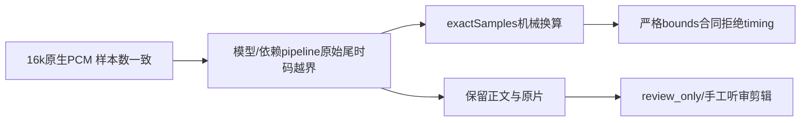

# T-1062 两份真实本地 ASR 时码只读诊断

结论：四份结果的尾部越界已存在于真实 Transformers.js pipeline 回执，发生在应用的整数样本映射和 source clock 处理之前。两份输入的 WAV 头、16 kHz/单声道 PCM 样本数与实际 driver 解码记录一致，没有发现业务映射或采样率错误。词级能力已启用；本机依赖存在可定位的 frame 单位风险，值得优先核查，但尚不能把它认定为两个模式全部越界的唯一根因。严格 segment/word timing 正证据仍为 **0/4**，正文返回成功不能写成词级剪辑成功。

## 本次审计边界

来源 tree `/Users/zyongzhu/.codex/worktrees/t1062-client-integration/Thirdspace-creator`，当场 HEAD `75131fb489962e50d483fe21baccab39e0350e89`。只读已有 JSON/raw、源代码、已生成日志和 WAV header，未运行产品、测试、新解码、第三份 ASR、模型或 network，没有改仓库或用户资料。仅写本 `/tmp` 报告与同名 JSON。报告 JSON 保存既有证据 SHA；五个 driver/validator 源文件与 alternate 汇总中的输入 SHA 均一致，两份 model cache 的七个模型文件逐字节一致。

## 当场可确定的事实

| 输入 | 模式 | WAV与driver样本数 / 精确秒数 | 最末raw时间范围（秒） | 原末样本 / 越界样本与秒 |
|---|---|---|---|---|
| original | segment | 228939 /14.3086875 | 4.6→14.6 | 233600 /4661，0.2913125s |
| original | word | 228939 /14.3086875 | 13.96→17.14 | 274240 /45301，2.8313125s |
| alternate | segment | 306587 /19.1616875 | 10.56→19.56 | 312960 /6373，0.3983125s |
| alternate | word | 306587 /19.1616875 | 18.36→19.4 | 310400 /3813，0.2383125s |

- 两份 WAV 均是 mono、16000Hz、2 bytes/sample，header frames 与各自 driver `decodedSampleCount` 一致。alternate 既有 ffprobe 回执还记录 source PCM_s16le、time_base=1/16000、start_pts=0、duration_ts=306587；容器格式显示的 6 位小数不是实际 sample clock 的真相。原 source MOV 的完整 native clock 映射在本组原始结果未记录，仍不能泛化声称编辑器时钟完全验证。
- 四份 raw chunks 均有可换算为精确整数样本的原十进制秒；全部已读 raw ranges 无零长度、倒序或重叠，确定的问题在各模式最后一项 end 超 valid count。没有通过 clamp、round、截尾或补静音改变证据。
- 原件 segment 返回 2 个 chunks、word 返回 50 个 provider 单位；alternate segment 2 个、word 65 个，正文长度分别 62/85 字符。本文不把 provider 中文单位重新拆字或宣称每单位已人工声学对齐；正文中存在识别用字差异，返回非空也不等于逐字正确。
- 原 probe 将真实 pipeline 返回直接保存在 `rawProviderOutput`；alternate 另存 `*-raw-provider.json`，公共 `readActualProviderTiming` 与 driver 都未提供 timing。alternate 公共 diagnosticSchema 在 segment ranges[1]、word ranges[64] 给出 bounds/identity 无效；本次只读算术核对出明确尾部越界，没有执行 validator 补拍测试。
- 业务 driver 在 `multimodal-whisper-local.ts:143` 推理前冻结 pcm.length；`:180` 先要求 timing sampleRate=16000 且 decoded count 与 valid count 一致，然后才读取真实 provider 时间码。`asr-provider-timing.ts:4–6` 原十进制秒用 BigInt 有理数乘 sampleRate，仅接受精确整数样本；`asset-asr-timing.ts:28` 验证顺序、身份和 end<=validSampleCount，任何项不合法则整份 timing 不返回。尾部越界不是这个映射制造的。
- 两输入均小于 20 秒，在真实 chunk_length_s=30、stride_length_s=5 的 jump=20 秒路径只生成一个 inference chunk；此次证据不指向长音频跨块 offset/拼接错误。
- alternate 透明记录为 macOS say/Tingting 合成中文口播，不是真人素材；其 native PCM/MOV 生成日志明确无音频静音添加、截尾、延长或重选。原输入的完整生成 provenance 没有本次 alternate 那样的同源脚本/命令记录，不能补称两者都经历相同输入验收。

## 能力配置与依赖风险

本机实际 `@xenova/transformers` 为 **2.17.2**。两份相同的 whisper-small generation_config 包含 10 组 alignment_heads。alternate 词级返回 options 记录 `return_timestamps:'word'`、`return_token_timestamps:true`、`num_frames:1916`，且成功返回真实 words/chunks。源码 `models.js:2855–2877` 缺 alignment_heads 或模型无 cross-attentions 会抛错；本次没有这类 adapter error。**不能将失败归因于“没有打开词级能力/缺 alignment_heads”。**

pipeline 内部会 `pop(language/task)`、写入 forced_decoder_ids/num_frames，并修改入参对象，所以 probe 保存的是调用后的 mutable options；那里没有 language 字段不代表 driver 忘记传 zh。实际 adapter 输入明确 language=zh，回执 options 的 decoder IDs 为 50260(zh)、50359(transcribe)。

可定位的强候选在词级 frame 域：

1. preprocessor_config 的 sampleRate=16000、hop_length=160，对应 feature hop=0.01s；`pipelines.js:1813` 设置 num_frames=floor(validSamples/160)，alternate 实测1916，原输入按源码应1430（原 probe未保留该实际值，故只是推导）。
2. 同一模型配置 max_source_positions=1500、chunk_length=30，`pipelines.js:1759` 与 `models.js:2896` 时间步为0.02s；DTW cross-attention 的 audio position 域因此与上述0.01s feature frame域不同。
3. `models.js:2917–2920` 直接用 num_frames 裁 cross_attentions `[0,num_frames]`，没有可见的域转换；`tensor.js:270–281` slice endpoint 自动限制在 actual tensor dimension。预处理 `processors.js:1533–1537` 将短音频特征填到30秒，因而若 runtime attention最后维是通常模型配置中的1500，则 alternate的1916 crop会保留全30秒位置；原推导1430则最多保留28.6秒位置，二者都超过真实14.3/19.16秒。
4. 随后的 token timestamps 经 pipeline 2位 round、tokenizer token-to-word 合并产生最终chunks；应用层当前原样使用这些 provider单位，不负责这种 rounding/DTW。

这已经是**源代码中有具体位置的单位不一致风险**，优先于盲目换样本。但实际两次没有保存模型 decoder sequences、cross-attention dims/weights、token timestamps，不能确定具体 tail 来自 padding区、EOS/标点归并、DTW或模型生成。segment来自生成 timestamp tokens（`tokenizers.js:3702`），也存在末端越界；单独修 word crop 不会自动证明 segment 正确。结论必须保留 **sole root cause=Unknown**，不是直接把 num_frames/2 当已证明修复。

## 下一最小有意义实验（本次未执行）

先在本机固定2.17.2及原model SHA，静态核对实际 ONNX encoder stride/cross-attention输出域，再安排**同一不可变 alternate WAV**的一次有界观测。不得换录音、延长或补静音凑正例。

一次 word推理同时记录 model.generate 所见 feature/attention dims、num_frames、原 decoder sequence和 timestamp token、完整 token_timestamps，保留原raw与错误。随后只用**该次已捕获的 tensors/tokens离线回放**现路径和按真实模型stride推导的 crop；不用再decode或生成第三份输入、不重跑模型挑绿。这能分开“frame单位导致的padding对齐”与“模型token/词边界自身问题”。任何建议变更都必须以模型真实单位为依据，不允许在最终chunks上裁剪/round/归一化尾时码。

验收仍在同源、同validSampleCount上逐项严格校验真实ranges，所有原units/id/order/bounds保留；保留原负例。即使 word同源成功，segment负例仍单独登记，精确声学对齐和public group/execution/receipt→native editor映射仍需相应真实证据，不能用一次通过覆盖未知输入族或把dependency版本升级当验证。

## 合法可用性降级

当前合约 `docs/features/t1062-rough-cut-contract.md:9,43,79–82` 允许保留全文和原片，给 review_only、手工听审/源范围明确选择或既有合法整片段建议；timing不足不能阻断其它创作、保存与导出。实际音轨可播放且源范围/时钟独立合法时，可供用户手工确定 in/out 编辑，但必须按该路径真实操作验收。

本结果**不能**自动生成逐词/整句切点或 pause_gap，不可按字数估时；不能声称词级粗剪、停顿自动采用、字幕联动成功。它能保留手工/整片段粗剪的可用路径，却不能填补 T-1062 的词句时码正例 Gate。两次 direct local probe 也没有验证公开组冻结、持久执行账本或 native editor 完整链。

证据入口：`/tmp/t1062-real-asr-alternate-probe.json`，两目录的 mode-result/raw JSON；具体路径、SHA、样本边界和 Unknown 详见 `/tmp/t1062-real-asr-timing-diagnosis.json`。无新增 network/模型/测试调用。
